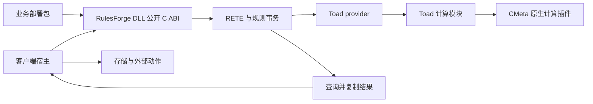

# RulesForge + Toad 二次开发指南

本指南面向使用 RulesForge DLL 开发业务应用的 C/C++ 开发者。扩展内容包括业务
schema、RFL 规则、Toad 计算模块、宿主适配器，以及可选的 CMeta 原生计算插件。

客户端以 `rulesforge.dll` 所代表的 RulesForge 共享库及公开 C ABI 为接入边界；
通过 SDK 导出的 `RulesForge::RulesForge` 目标链接。当前 LLVM-MinGW 产物的实际
文件名为 `libRulesForge.dll`，导入库为 `libRulesForge.dll.a`。文件名按 SDK 的
编译器/profile 选择，应用不手工拼接或重命名导入库。

本文依据当前 checkout 的公开头文件、可运行示例和已选用的 Toad 0.1.3 发布 SDK。
消费 SDK 时，应核对其源提交、公开头文件、provider 和上游版本是否与需要的能力
一致；项目版本字符串不能代替这项匹配。

## 阅读路线

| 开发目标 | 从哪里开始 |
|---|---|
| 在已有客户端接入规则和脚本 | [SDK与DLL接入](#sdk与dll接入)、[最小业务开发](#最小业务开发) |
| 增加自己的业务规则和复杂计算 | [多阶段业务与规则设计](#多阶段业务与规则设计) |
| 将模拟输入、存储、动作替换成真实服务 | [接入真实输入与持久化](#接入真实输入与持久化) |
| 在 Toad 中复用现有 C/C++ 算法 | [扩展原生计算模块](#扩展原生计算模块) |
| 并发执行、热更新与关闭 | [生命周期与热更新](#生命周期与热更新) |
| 建立回归与交付流程 | [测试与交付](#测试与交付) |

职责分配如下：

| 层 | 开发者提供的内容 | 运行期职责 |
|---|---|---|
| 宿主应用 | API/消息/设备适配器、存储与动作处理 | 驱动输入、线程、时钟、持久化和外部副作用 |
| DataBind | `.schema` | 校验并绑定外部数据，定义计算参数和结果形状 |
| RulesForge DLL | RFL、Program bundle、公开 C ABI 调用 | 事实、RETE 关联、窗口、议程、规则事务和查询 |
| Toad provider/runtime | `.toad` 模块、显式函数绑定 | 执行受准入约束的业务计算，返回类型化结果 |
| 可选原生插件 | CMeta Function 声明和插件 DSO | 在既有 Plugin ABI 下提供同步原生计算 |



原生插件是可选扩展；脚本计算可以直接返回结果。客户端不需要包含
`core/include`、链接内部 `engine` / `rfl_parser`，或调用 Toad 内部执行入口。

## SDK与DLL接入

### 编译期

使用同一轮匹配编译器、架构和精确发布版本的 SDK。依赖恢复入口和环境字段见
[上游依赖说明](../README.md#upstream-dependency-versions)。CMake 不自动加载
`.env`；加载后的父环境和 SDK package config 是配置事实源。

客户端已有 `my_app` target 时，链接方式为：

```cmake
find_package(RulesForge CONFIG REQUIRED)
target_link_libraries(my_app PRIVATE RulesForge::RulesForge)
```

客户端源文件包含 `<rules_forge.h>`。该头还使用 Base/DataBind 的公开类型，因此
需要匹配 SDK 的传递头文件和依赖配置；复制一个 DLL 和一个头文件不构成完整的编译
SDK。导出 target 负责所需 include/link 关系。不要定义库内部的
`RULES_FORGE_BUILD` 宏。

公开契约以 [rules_forge.h](../rulesforge/include/rules_forge.h) 为准。
`rulesforge_example_support`、`scenario_support::Program` 等是仓库示例辅助代码，
不属于安装 SDK，也不作为下游应用的链接依赖。

### 运行期

应用部署需要 RulesForge DLL、匹配的动态依赖、Toad provider/runtime，以及业务
bundle。客户端调用 RulesForge；Program 根据 bundle 选择 provider，由 provider
管理 Toad 上下文及原生插件准入。业务客户端无需直接链接 Toad Engine。

一个 Windows LLVM-MinGW 部署可以组织为：

```text
app/
  my_app.exe
  libRulesForge.dll
  与 SDK 匹配的动态依赖
  rules/
    bundle.json
    librulesforge_toad.dll
    order.schema
    pricing.rfl
    pricing.toad
    tax.toad
```

这里的两个 DLL 名称来自当前 LLVM-MinGW 构建；其他 profile 使用对应 SDK 的文件。
provider 放入 bundle 目录，其他动态依赖按应用的动态库搜索/安装策略交付。完整依赖
闭包和许可材料从 SDK 清单取得，不能用开发机 PATH 的偶然可用性代替部署验证。

bundle 引用的规则、schema、脚本及原生模块路径必须位于部署目录内，包括符号链接
解析后的目标。`.json.in`、`$<TARGET_FILE_NAME:...>` 和 `@...@` 是构建期模板；
运行期传入的是已生成、路径已解析的 `bundle.json`。

## 最小业务开发

以现有的两模块计价示例贯穿 DLL 接入流程：输入订单金额 15，先计算
`amount + 5`，再乘 2，最终订单 `total = 40`、`done = true`。

下面的 schema、RFL、脚本、bundle 和完整客户端来自已有 Program fixture 与可运行
示例。它们可以作为业务应用的起点；SDK 使用者准备自己的业务部署目录。

### 定义输入与计算契约

`order.schema`：

```text
schema ScriptPricing [id(1), version(1), byte_order(little)];
message Order { double amount; double total; bool done; }
message Price { double total; }
```

`Order` 是外部事实，`Price` 是计算结果记录。RFL 导入这份 schema，Program 的
`signatures` 也使用它。外部类型只在 schema 中定义；派生事实可以在 RFL 中
`declare`，不要为同一输入类型再维护一份 RFL 声明。

这个动态绑定流程不会自动生成业务 C/C++ 结构体。需要原生结构映射时，使用
DataBind 已有的 typed descriptor 或构建期 schema 代码生成路线，参考
[锅炉房示例](../examples/boiler_room/README.md)；运行时不编译业务结构体。

### 编写Toad模块

`pricing.toad`：

```text
func calculate(amount) { return map {total: amount + 5}; };
export("calculate");
```

`tax.toad`：

```text
func calculate(amount) { return amount * 2; };
export("calculate");
```

模块通过 `export` 暴露命名函数。两份文件都可以叫 `calculate`，bundle 的模块名
负责区分。这里的 tax 只是第二阶段示范计算，不是实际税务模型。

规则通过同步 CALL 传入类型化值；计算结果按签名验证并复制后交回 RulesForge。
每次 CALL 使用新实例，脚本全局变量不会跨调用保留。跨事件状态、缓存窗口和业务
进度应由事实或宿主持有，并作为显式输入提供。

### 编写RFL规则

`pricing.rfl`：

```rfl
import schema "order.schema"
rule "Price"
when
    $order: Order(done == false)
then
    call "pricing.calculate"($order.amount) into $price
    call "tax.calculate"($price.total) into $total
    update $order { total = $total, done = true }
end
```

`done == false` 是本例的执行条件；成功时设置 `done = true`，使同一订单不会继续
激活这条规则。两个 CALL 和 UPDATE 属于同一次 RHS 事务。第二次 CALL 失败时，
本条规则的事实变更按现有回滚契约处理。

### 声明Program绑定

以下是当前 Windows LLVM-MinGW Program fixture 的已生成 bundle：

```json
{
  "provider": "librulesforge_toad.dll",
  "rules": "pricing.rfl",
  "signatures": "order.schema",
  "mode": "interpreter",
  "modules": [
    {
      "name": "pricing",
      "path": "pricing.toad"
    },
    {
      "name": "tax",
      "path": "tax.toad"
    }
  ],
  "bindings": [
    {
      "name": "pricing.calculate",
      "module": "pricing",
      "function": "calculate",
      "parameters": [
        "double"
      ],
      "result": "Price"
    },
    {
      "name": "tax.calculate",
      "module": "tax",
      "function": "calculate",
      "parameters": [
        "double"
      ],
      "result": "double"
    }
  ],
  "limits": {
    "source_bytes": 4194304,
    "value_bytes": 4194304,
    "value_nodes": 65536,
    "value_depth": 64,
    "steps": 100000,
    "loops": 10000,
    "recursion": 100,
    "retained_bytes": 134217728,
    "stack_bytes": 1048576,
    "max_sessions": 8
  }
}
```

需要同时对应四处名称：

| 名称 | 示例 | 作用 |
|---|---|---|
| RFL binding | `pricing.calculate` | RFL 的静态 CALL 标识 |
| bundle module | `pricing` | 选择脚本模块 |
| script function/export | `calculate` | 选择已导出的命名函数 |
| schema result | `Price` | 验证返回记录的字段和类型 |

`Price` 的返回值必须精确包含 `total` 字段。`tax.calculate` 的结果是
`double`。函数的参数顺序、数量和类型必须与绑定一致，CALL 参数使用受支持的字段
引用、字面量或前一次计算结果；整体 Fact/Token 指针不进入计算边界。

所有 limits 都是必需的正值。示例数值是该场景的配置，不是生产容量建议。具体限额
和可用类型见 [Script Programs](SCRIPT_PROGRAM.md)。`mode` 只选择 Toad
interpreter/JIT；core RFL 标量表达式仍走其自身的 MIR 执行契约。

设计 CALL 签名时，还要区分 DataBind 输入能力与当前脚本桥支持的形状：

- 使用明确的标量或命名 message；结果记录的字段集合和类型必须完全匹配。
- 脚本算术产生的 NUMBER 声明为 `double`，不隐式转换为 `int64` 或 Money。
  大整数、Decimal/Money 的精确传输不等于任意精度计算；算法需要明确数值域。
- 当前桥的 `uint64` 限于 INT64_MAX。可空字段、嵌套记录和列表按已支持形状处理；
  optional/default、enum、时间、bytes、set、任意 map 等签名形式以 Program 文档
  的当前拒绝范围为准，不能因外部绑定支持它们就假定 CALL 也支持。
- Program 启用 explicit-call 准入：命名脚本 helper 和已配置原生 Functions 可参与
  计算；ambient I/O、脚本 import/eval、动态成员调用等形式被拒绝。跨模块计算可像
  本例一样由 RFL 的不同 bindings 显式串联。

### 编写DLL客户端

下面是 [script_program_demo.cpp](../examples/script_program/script_program_demo.cpp)
中的完整客户端。它只通过公开 C ABI 创建 Program、创建 session、插入数据和执行；
错误在清理前报告，清理失败不会被当成成功。

```cpp
#include "rules_forge.h"
#include <cstdio>
#include <string>

int main(int argc, char **argv) {
  if (argc != 4) {
    std::fprintf(stderr, "Usage: script_program_demo <bundle.json> <fact-type> <fact-json>\n");
    return 2;
  }
  ruleforge_program_t program = nullptr;
  ruleforge_stateful_session_t session = nullptr;
  int fired = 0;
  auto status = ruleforge_program_create(argv[1], &program);
  if (status == RULES_FORGE_OK)
    status = ruleforge_program_create_session(program, &session);
  if (status == RULES_FORGE_OK)
    status = ruleforge_session_add_fact_json(session, argv[2], argv[3], nullptr);
  if (status == RULES_FORGE_OK)
    status = ruleforge_session_fire_all_rules(session, 1000, &fired);
  if (status != RULES_FORGE_OK)
    std::fprintf(stderr, "%s\n", ruleforge_get_last_error_message());
  if (session) {
    auto closed = ruleforge_session_destroy(session);
    if (closed != RULES_FORGE_OK) {
      std::fprintf(stderr, "%s\n", ruleforge_get_last_error_message());
      return 1; // Program must remain alive while session cleanup still owns it.
    }
  }
  if (program) {
    auto closed = ruleforge_program_close(program);
    if (closed == RULES_FORGE_OK)
      closed = ruleforge_program_destroy(program);
    if (closed != RULES_FORGE_OK) {
      std::fprintf(stderr, "%s\n", ruleforge_get_last_error_message());
      return 1;
    }
  }
  if (status != RULES_FORGE_OK)
    return 1;
  std::printf("fired=%d\n", fired);
  return 0;
}
```

将该源文件放入客户端自己的应用 target，通过 `RulesForge::RulesForge` 链接。
客户端编译完成后，从应用目录调用：

```powershell
./my_app.exe ./rules/bundle.json Order '{"amount":15,"total":0,"done":false}'
```

这个最小客户端打印 `fired=1`，不打印订单字段。完整仓库回归另外检查了
`total = 40`；不能把 firing 数量当成业务结果的替代品。

### 读取业务结果

保留插入时返回的 session-owned fact handle，可以读取被规则更新后的字段。
下面的应用侧函数借用 session，将每次调用的错误码直接返回给宿主：

```c
static ruleforge_status_t price_order(ruleforge_stateful_session_t session,
                                      double *out_total) {
    ruleforge_fact_t order = NULL;
    ruleforge_status_t status = ruleforge_session_add_fact_json(
        session, "Order", "{\"amount\":15,\"total\":0,\"done\":false}", &order);
    if (status != RULES_FORGE_OK)
        return status;

    int fired = 0;
    status = ruleforge_session_fire_all_rules(session, 1000, &fired);
    if (status != RULES_FORGE_OK)
        return status;

    return ruleforge_fact_get_field_as_double(order, "total", out_total);
}
```

`price_order` 是本文的客户端辅助函数，不是 RulesForge 新增 API。调用者检查返回
状态、读取诊断并负责 session 生命周期；失败输出不能当成有效金额使用。

对多个派生结果，应定义命名查询，例如质量示例中的
`query "Decisions" $row: Decision() end`。公开调用顺序为：

| 步骤 | 公开 API | 所有权 |
|---|---|---|
| 执行查询 | `ruleforge_session_query` | 返回 query handle，由调用方销毁 |
| 获取行数 | `ruleforge_query_result_get_size` | 小于 0 表示错误；成功行数仍需按业务要求检查 |
| 获取绑定事实 | `ruleforge_query_result_get_fact_at_index` | 传绑定名 `"row"`；返回 fact 由 query 拥有 |
| 复制字段 | `ruleforge_fact_get_field_as_*` | 复制到应用自己的值/有界缓冲区 |
| 结束查询 | `ruleforge_query_result_destroy` | 随后 query-owned fact handle 失效 |

session-owned 和 query-owned fact handle 都不能由应用直接释放。跨异步调用、
队列或 session 销毁前先复制结果，不能保存借用的 handle 或字符视图。

## 多阶段业务与规则设计

[质量放行](../examples/quality_release/README.md)展示了更完整的业务分工：

```text
Batch + ProductSpec
  → Toad assess
  → Metrics 事实
  → Calibration / 规格 / 离散度规则
  → RELEASE / RECHECK / HOLD 决策
```

计算规则先产生可复用的 Metrics，其他规则根据事实执行不同决策。这使计算模型、
匹配条件和外部动作分别有明确归属。公开 C API 没有注册任意 Toad LHS 谓词的入口；
需要让复杂计算参与后续匹配时，先通过 RHS CALL 生成派生事实，再由后续规则匹配。

开发新业务时，先确定下列契约，再修改文件：

| 契约 | 需要明确的内容 |
|---|---|
| 输入事实 | 业务主键、单位、时间含义、必需字段、来源和有效性 |
| 状态 | 哪些事实跨步骤保留，何时更新/撤销，何时清理 session |
| 计算 | 参数形状、数值范围、返回类型、非法输入的失败方式 |
| 决策 | 唯一 ID、动作、原因、对象、指标单位，结果缺失是否允许 |
| 时间/窗口 | 到达顺序或事件时间、分区、ready 条件、过期与迟到策略 |
| 外部效果 | 哪个宿主组件执行，何时提交，如何确认与去重 |

单个请求的生命周期通常是创建 session、插入有限输入、firing、查询/复制结果、
销毁 session。阶段之间必须观察派生事实时，由宿主显式设置 firing 检查点。议程
优先级是规则执行机制，不代替应用的持久工作流或输入提交协议。

Program 当前只创建 stateful session。冷链样例的显式 length 窗口不能直接代表
按键分区或事件时间处理；ContinuousSession 的 watermark/去重/恢复契约见
[连续引擎文档](CONTINUOUS_RULE_ENGINE_DESIGN.md)，其与 Program/Toad 的公开组合
尚未提供。

能源示例中的“优化”是对 27 个候选计划计算成本、筛选可行方案并选出最小值。
更大规模求解可以由宿主优化组件生成类型化候选事实，再交给 RulesForge 校验与
选择。当前原生插件边界只有受准入约束的标量 Functions，不能据此假定任意求解器
对象、数组或复杂模型可以直接穿过原生 ABI。详见
[优化与求解器](SCENARIOS.md#optimization-and-solvers)。

## 接入真实输入与持久化

七个场景中的 mock API 是宿主适配器示范，不是 DLL 提供的网络/数据库接口。
下游根据自己的业务服务实现这些职责：

| 适配器职责 | mock 参考 | 真实接入时保留的契约 |
|---|---|---|
| 取数与规范化 | `MockInputApi::fetch` | 明确来源、字段/单位、缓冲区寿命、容量和错误 |
| 规则执行调度 | `execute` 的调用顺序 | 一个 owner 驱动 session；检查状态和业务结果完整性 |
| 决策存储 | `MockDecisionApi::commit` | 稳定 ID、整批提交、冲突检测、明确失败状态 |
| 外部投递 | `deliver` / `MockActionApi::send` | 明确 pending/ack、接收方幂等、重复与失败语义 |

应用不需要链接这些 mock 类。可以参考它们的协议，在自己的代码中直接调用 DLL
公开 API。JSON/YAML/CSV/XML/binary 输入都经导入 schema 的公开入口绑定，不需要
在宿主或脚本中再实现一套 JSON 解析器。已持有的 DataBind object/value 可通过公开
插入函数复制进入 session；其原始所有权仍归调用方。

多生产者接入时，由应用在 session owner 之前使用明确容量和关闭协议的输入通道。
Program session 及其派生 handle/stream 固定在创建线程；不要让网络回调和数据库
回调并发操作同一 session。

规则事务只覆盖引擎事实状态。真实存储应定义决策与 pending-delivery 状态的数据库
提交边界，外部系统应定义业务幂等键与确认语义。RHS 回滚无法撤销已发送的设备命令
或外部服务写入。脚本/原生计算返回请求或结果，由宿主在成功边界之后执行副作用。

mock 的 128 条输入、64 条决策/动作及 95 字节文本是示例宿主上限，不能当成引擎
整体内存上限。存储失败不投递，投递失败保留 pending；后续重新投递必须由应用明确
驱动。完整状态语义和已有测试见 [场景宿主契约](SCENARIOS.md#ownership-and-mock-apis)。

## 扩展原生计算模块

需要复用现有 C/C++ 数学库时，在 Toad 的已准入函数集合中增加原生 Function。
参考文件是 [native_math.cpp](../examples/maintenance/native_math.cpp)；
对应完整调用链为：

```text
RFL CALL → Toad 命名函数 → CMeta Function → C/C++ 算法 → 类型化结果 → RHS 更新
```

### 声明和发布

下面是维护示例的完整原生模块，使用发布 SDK 的 `<toad/plugin.h>`：

```cpp
#include <cmath>
#include <limits>
#include <toad/plugin.h>

TOAD_PLUGIN_FUNCTION(double, maintenance_risk_score, (double, mean, CMETA_PARAM_IN),
                     (double, variance, CMETA_PARAM_IN), (double, roughness, CMETA_PARAM_IN),
                     (double, baseline, CMETA_PARAM_IN));

double maintenance_risk_score(double mean, double variance, double roughness, double baseline) {
  // Non-finite results are the scalar bridge's explicit HOST_ERROR boundary.
  if (baseline <= 0 || variance < 0 || roughness < 0)
    return std::numeric_limits<double>::quiet_NaN();
  double scale = baseline * baseline;
  if (!std::isfinite(scale) || scale == 0)
    return std::numeric_limits<double>::quiet_NaN();
  double risk = 10.0 * variance / scale + 5.0 * roughness / scale +
                10.0 * std::abs(mean - baseline) / baseline;
  if (!std::isfinite(risk))
    return std::numeric_limits<double>::quiet_NaN();
  return risk > 100.0 ? 100.0 : risk;
}

TOAD_PLUGIN_FUNCTION(double, maintenance_expected_loss, (double, mean_risk, CMETA_PARAM_IN),
                     (double, failure_cost, CMETA_PARAM_IN), (double, criticality, CMETA_PARAM_IN));

double maintenance_expected_loss(double mean_risk, double failure_cost, double criticality) {
  if (mean_risk < 0 || failure_cost < 0 || criticality <= 0)
    return std::numeric_limits<double>::quiet_NaN();
  return mean_risk / 100.0 * failure_cost * criticality;
}

#define MAINTENANCE_EXPORTS(X)                                                                     \
  X(function, maintenance_risk_score, "maintenance_risk_score", "maintenance.math", 1u, 0u)        \
  X(function, maintenance_expected_loss, "maintenance_expected_loss", "maintenance.math", 1u, 0u)
CMETA_PLUGIN_DECLARE(maintenance_math, "maintenance.math", (1u, 0u, 0u), MAINTENANCE_EXPORTS,
                     CMETA_PLUGIN_PASSIVE());
```

开发自己的模块时，从这一完整文件调整函数及导出列表：

1. 使用 `TOAD_PLUGIN_FUNCTION` 描述真实函数的返回类型、参数和方向。
2. 实现同步计算函数，保留输入、数值和所有权校验。
3. 在唯一的 export list 中发布函数 ID、contract 和现有元数据。
4. 每个 DSO 使用一次 `CMETA_PLUGIN_DECLARE(..., CMETA_PLUGIN_PASSIVE())`。
5. 将模块放入部署目录，在 bundle 的 `native_modules` 中显式列出。

Function 声明生成适配元数据，不需要手写第二套 vtable、签名注册表或动态加载器。
模块构建时链接现有 `Toad::PluginABI` 目标，维护示例中的链接语句是：

```cmake
target_link_libraries(maintenance_math PRIVATE Toad::PluginABI)
```

这个 target 用于原生插件生产者。普通 DLL 客户端继续链接
`RulesForge::RulesForge`，不把插件生产者的 target 当成规则引擎入口。

### 部署和调用

维护示例的构建期 bundle 片段：

```json
{
  "native_modules": [{"path":"$<TARGET_FILE_NAME:maintenance_math>"}]
}
```

这是加入完整 `bundle.json.in` 的片段；构建时替换生成表达式，运行期文件中使用
实际 DSO 名。不是将这段 JSON 单独当成完整 Program bundle。

Toad 脚本直接使用已发布的函数 ID，例如：

```text
monitor = maintenance_expected_loss(meanRisk, model.failureCost, model.criticality);
```

Program 管理 generation-owned registry；provider 在编译脚本前附加 Functions，
并持有执行所需 leases。客户端无需自己创建 registry 或调用 `LoadLibrary` 注册。

### 原生边界

当前 RulesForge provider 接受 passive scalar Function manifests。Toad SDK 中
其他 module/interface/stateful 声明能力不代表此 provider 也接受这些形式。受支持的
原生签名及返回值必须通过当前发布头文件和准入检查，不能直接传递 C++ 容器、异常、
整个 Fact 指针或宿主对象。

多个 session owner 可以同时调用同一个原生 DSO；函数应支持并发调用，不保留借用
参数、不让异常越过 C ABI、不执行无法由规则回滚撤销的副作用。示例将非法数值域
返回为非有限标量，由标量桥转成 HOST_ERROR 并传播为 RHS 错误；这不是有效业务结果。

这些插件是受信任的宿主代码。脚本 explicit-call 准入与原生签名验证不提供进程隔离
或硬 CPU 超时保证。完整关闭、lease 和函数准入规则见
[Program 原生计算契约](SCRIPT_PROGRAM.md#application-defined-native-computation)。

## 生命周期与热更新

| 对象 | 归属与结束条件 |
|---|---|
| Program | 应用持有；管理已发布的规则/schema/脚本/原生模块 generation |
| Program session | 固定在创建线程；保留创建时的 generation |
| 输入 fact handle | 由 session 拥有 |
| query handle / 查询 fact | query 由应用销毁；查询 fact 随 query 失效 |
| CALL 参数和结果 | 参数同步借用；结果验证并复制，随后实例结束 |
| 原生 DSO / Function metadata | 由 generation 和 leases 保持到最后一个借用者结束 |

`ruleforge_program_reload` 构建并校验完整候选后才发布。失败保留当前 generation；
新 session 使用新 generation，已有 session 保留原规则、schema、脚本和原生模块。
当前允许两个 attached generations；两者仍被占用时继续更新会返回 RESOURCE_LIMIT。
应用通过会话生命周期释放旧 generation，不强迁移已有会话。

原生更新使用不同的不可变 DSO 路径。provider/runtime 升级使用新的 Program 或
进程部署；同一 Program 的 provider 路径固定。不要覆盖仍被加载的模块文件。

关闭时先停止宿主接入、结束输入和查询，销毁所有 session，再调用
`ruleforge_program_close` 和 `ruleforge_program_destroy`。close 是永久关闭准入，
已有 session 仍须正常释放。Program 控制操作由调用者串行化；destroy 排除所有并发
Program API 调用。清理失败仍保留原有义务，不能据此继续销毁被依赖的 owner。

RHS 失败回滚当前规则，先前已提交的规则仍保留。回滚失败或非事务传播错误导致的
不一致 session 必须显式成功 reset 或销毁重建；reset 清空事实，不恢复应用业务
历史。诊断由 `ruleforge_get_last_error_message()` 取得，在同线程后续 API/清理调用
前读取。详细状态和错误码见 [用户指南](USER_GUIDE.md#error-handling)。

## 测试与交付

业务回归至少覆盖下列可观察结果：

| 范围 | 需要验证的行为 |
|---|---|
| schema | 必需字段、错误类型、嵌套形状、数值范围和所有权 |
| 规则 | 匹配/不匹配、关联隔离、重复激活、边界条件和原因码 |
| 计算 | 正常值、非法域、溢出/非有限、返回字段与类型、解释器/JIT |
| 阶段和窗口 | ready、检查点、退出窗口、其他对象的隔离 |
| 宿主 | 结果缺失、稳定 ID、原子存储失败、重复与冲突、投递确认 |
| 原生模块 | 导出/签名准入、缺失和重复模块、并发、数值失败与 leases |
| 热更新 | 候选失败、旧 session 固定、新 session 切换及容量限制 |

现有测试可以作为起点：
[Program 回归](../rulesforge/tests/script_program_test.cpp)、
[质量回归](../examples/quality_release/tests/quality_test.cpp)、
[原生维护回归](../rulesforge/tests/maintenance_program_test.cpp)和
[mock 协议回归](../examples/support/tests/mock_api_test.cpp)。

在 RulesForge 仓库内扩展示例时，源码与测试归自己的 `examples/<domain>/`，
测试使用 TinyTest，CMake 注册参考对应目录及
[Scenario helper](../examples/support/Scenario.cmake)。这些是仓库贡献方式；SDK 客户端
使用自己的应用工程、测试和发布流程，继续通过 DLL 的公开接口测试业务行为。

已有 RulesForge 正式入口可用于检查参考实现；从仓库根目录加载 SDK 环境后逐条执行：

```powershell
cmake --preset llvm-mingw-x64-release-user -DBUILD_TESTS=ON -DBUILD_BENCHMARK=ON
cmake --build --preset llvm-mingw-x64-release-user --parallel 3
ctest --preset llvm-mingw-x64-release-user -L '^scenario$' -j 1 -V --no-tests=error
ctest --preset llvm-mingw-x64-release-user -j 1 --output-on-failure --no-tests=error
```

每条命令成功后再执行下一条。上述命令验证仓库参考实现，不要求下游把
RulesForge 源码作为应用构建依赖。2026-11-16 的记录为 Windows LLVM-MinGW x64
Release 完整构建及 79/79 CTest、新增 47 个 TinyTest case；详见
[验证记录](SCENARIOS.md#recorded-verification)。这不替代下游应用自己的交付验收，
也不表示所有业务输入都在两个模式或其他平台上验证。

交付时将匹配的 DLL/导入库/头文件及依赖、provider、业务 bundle、schema、脚本和
必要的原生 DSO 作为一致的应用版本管理。容量、输入时间语义、数值精度和持久投递
契约由应用明确记录。SDK 的发布来源与打包约束见
[原生 SDK 说明](../packaging/nuget/README.md)。

## 常见问题

| 现象 | 核对位置 |
|---|---|
| 客户端找不到头文件或依赖 target | SDK package、传递依赖 roots、编译器/profile；使用 REQUIRED 查找，不猜测其他安装 |
| 找不到 DLL/provider | 实际 SDK 文件名、动态依赖闭包和 bundle 内 provider 路径 |
| 普通 KB 加载含 CALL 规则失败 | 通过 Program bundle 建立 bindings 后创建 session |
| 找不到脚本函数 | module 名、函数名、export、RFL binding 四者对应关系 |
| 返回值不符合签名 | 记录字段集合、整数/NUMBER 区别、嵌套形状及参数顺序 |
| 原生模块声明了仍无法调用 | export ID、passive scalar 准入、native_modules 和发布 SDK ABI |
| firing 成功但业务结果不完整 | 查询完整性、输入 join 键、缺少事实、门槛和 firing 预算；fired 数不代表业务成功 |
| 计算值丢精度 | 区分 RFL 整数语义与 Toad NUMBER；限定数值域或选择明确的原生算法契约 |
| reload 后旧会话未变化 | 旧 session 固定原 generation，创建新 session 才使用新包 |
| 启用 JIT 后脚本错误 | 错误直接传播，修复脚本/配置；不自动回到解释器 |

更多可运行业务见 [七类场景](SCENARIOS.md)，规则语法见 [RFL 参考](dsl.md)，
生产环境配置见 [部署指南](DEPLOYMENT.md)。
