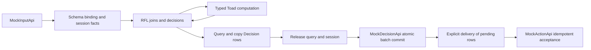

# Runnable Domain Scenarios

Seven examples combine RulesForge matching with typed Toad computations through
the installed C ABI. Each has an executable, a schema, RFL rules, a script module,
interpreter/JIT bundles, mock API input and formal regression tests.

To build your own application using the RulesForge DLL, begin with the
[development guide](DEVELOPMENT_GUIDE.md). The source-tree scenario host and mock
classes are reference implementations rather than installed SDK targets.

## Choose a Scenario

| Scenario | Evidence and decision | Default result | Meaning of metric |
|---|---|---|---|
| [Quality release](../examples/quality_release/README.md) | Measurements, specification and calibration | `lot-1`: RELEASE | Normalized population variance, approximately 0.00166666667 |
| [Energy dispatch](../examples/energy_dispatch/README.md) | Battery plans, SOC/grid constraints and costs | `dispatch-1`: PROPOSE `P08` | Modeled cost 2.72 |
| [Cold chain](../examples/cold_chain/README.md) | Interval exposure and an explicit cargo window | `review-1`: HOLD; `review-2`: CONTINUE | Recent exposure 30, then 10 degree-minutes |
| [Production routing](../examples/production_routing/README.md) | Predecessor, material, worker and machine availability | `plan-cut`: ASSIGN `cut-fast`; `plan-coat`: WAIT | Assignment cost 42; WAIT carries 0 |
| [Release admission](../examples/release_gate/README.md) | Test/security evidence, environment and approval | `review-7`: APPROVE | Illustrative risk score 12 |
| [Reconciliation](../examples/reconciliation/README.md) | Source/target values, unit model and business keys | MATCH, MISMATCH, MISSING and CONFLICT | Absolute difference after conversion; unmatched/conflicting records carry 0 |
| [Service entitlements](../examples/service_entitlements/README.md) | Usage, active account and enabled regional plans | `quote-1`: SELECT_PLAN `pro` | 2300 integral cents |

The values and policies are deterministic fixtures. Domain READMEs describe
alternative inputs, assertions and model limits. Numerical zero in a nonnumeric
decision such as WAIT or MISSING does not mean a successful comparison.

All seven use stateful Program sessions. The cold-chain sample uses an explicit
`cargo-1` length window with host-driven input checkpoints. It does not implement
implicit per-key partitioning or event-time lateness handling. For event IDs,
watermarks and retained event-time state, see the
[continuous-session contract](CONTINUOUS_RULE_ENGINE_DESIGN.md). Continuous Program
sessions with Toad are not exposed by the current public API.

## Build and Run

Run from the repository root after restoring and loading the exact SDK environment
described in the [root README](../README.md#build). CMake does not load `.env`.
Execute the next command only when the preceding command succeeds:

```powershell
cmake --preset llvm-mingw-x64-release-user -DBUILD_TESTS=ON
cmake --build --preset llvm-mingw-x64-release-user --parallel 3
ctest --preset llvm-mingw-x64-release-user -L '^scenario$' -j 1 -V --no-tests=error
```

The label selects 15 CTest entries: seven demos, seven business test executables
and one shared mock API test executable. The complete build graph is retained.
To select one domain:

```powershell
ctest --preset llvm-mingw-x64-release-user -R '^energy_dispatch_(test|demo\.example)$' -V --no-tests=error
```

The energy executable can also select its explicit JIT bundle:

```powershell
./build/llvm-mingw-x64-release-user/bin/energy_dispatch_demo.exe ./build/llvm-mingw-x64-release-user/examples/energy_dispatch/bundle/bundle-jit.json
```

Each domain has the same generated deployment layout under
`build/llvm-mingw-x64-release-user/examples/<domain>/bundle/`: schema, RFL, script,
provider and `bundle-interpreter.json` / `bundle-jit.json`. Provider/runtime
dependencies follow the existing [Program deployment contract](SCRIPT_PROGRAM.md).
Changing the bundle mode selects Toad execution; core scalar MIR execution is
unchanged. There is no automatic mode fallback.

## Ownership and Mock APIs

The shared [host adapter](../examples/support/runtime.hpp) implements this sequence:



The host owns fetching, input order, checkpoints, persistence and delivery.
RulesForge owns facts, joins, agenda and per-rule transactions. Toad receives
typed inputs and returns computation results. Each Program/session has one owner
thread; these examples start no background worker or external service.

`MockInputApi` borrows the immutable JSON strings in `input.hpp`. Insertion binds
them synchronously through the domain schema. A record marked `checkpoint`
fires rules before the next input record; cold-chain reviews therefore observe
already computed exposure facts. Source buffers must remain valid until insertion
finishes. Query facts are borrowed; `execute()` copies the result fields before
destroying the query and session.

The example-level query is named `Decisions`, with binding `row`. Its copied
record has five fields:

| Field | Contract |
|---|---|
| `id` | Nonempty immutable decision ID, used as the persistence/delivery idempotency key |
| `action` | Domain result such as HOLD, PROPOSE or SELECT_PLAN |
| `reason` | Rule-selected explanation code |
| `target` | Domain identifier such as a machine, plan or environment |
| `metric` | Finite number with the unit documented for that domain |

This shape belongs to the examples, not to a new RulesForge public ABI.
The demo checks its expected decision count before persistence, commits only
after successful execution, and performs delivery after the commit. The mock
sink records every decision, including WAIT and MISSING; it deploys no software
and sends no equipment command.

| Mock resource | Limit and full behavior |
|---|---|
| Input fetch | At most 128 records; excess fails before insertion |
| Copied decision batch | At most 64 rows; zero rows or excess fails |
| Persisted decisions | At most 64 distinct IDs; excess rejects the whole commit |
| Accepted actions | At most 64 distinct IDs; excess fails |
| Each copied text field | At most 95 bytes plus NUL; oversized text fails |

These are record/text limits, not an input-payload byte budget or a process RSS
limit. Each mock object is single-threaded. The repository can outlive sessions,
but it is destroyed when the process exits.

Each demo evaluates the same input twice in fresh sessions while retaining the
repository and sink. Identical decisions reuse their IDs without adding rows or
delivering twice; differing content under an existing ID fails. Successful runs
print `persisted=N delivered=N replay=idempotent`. Expected N is 1 for quality,
energy, release and tariffs; 2 for cold chain and routing; 4 for reconciliation.

## Failure and Production Adapters

Input, schema, computation or query failure stops the run before persistence.
A persistence failure leaves the original mock table unchanged and sends no
actions. A delivery failure leaves the committed row pending; earlier accepted
rows can already be marked delivered. A later explicit delivery call can consume
pending rows. No layer automatically retries or changes implementation.

When replacing mocks, keep storage and delivery in the host. Define stable
decision IDs and reject conflicting reuse. Copy borrowed data before crossing
thread or asynchronous boundaries. Commit decision records and pending-delivery
state with the chosen database's transaction contract; define acknowledgement
and recipient idempotency explicitly. The example's in-memory delivered flag
does not provide crash recovery or exactly-once external effects.

Rule transactions, repository commits and external delivery are separate
boundaries. No distributed transaction is provided. Input checkpoints can commit
earlier rules before a later computation fails; see the
[stateful failure contract](USER_GUIDE.md#error-handling).

For request/response data, follow [Data ingestion](DATA_INGESTION.md). For native
computation modules, follow [Script Programs](SCRIPT_PROGRAM.md) and the existing
[maintenance example](../examples/maintenance/README.md). Business constraints
stay in RFL; the shared adapter contains no second JSON parser or rule evaluator.

## Optimization and Solvers

An optimization model has decision variables, constraints and an objective.
RulesForge can check policy and feasibility and compare candidate facts. Toad
computes their numerical properties. A dedicated solver can search a much larger
assignment space through an explicit computation boundary.

The energy example has three one-hour actions, each chosen from {-2, 0, +2} kW.
The candidate count is 3³ = 27. Toad computes cost and SOC/grid trajectories;
RETE admits feasible candidates and rejects any candidate with a cheaper feasible
competitor. Equal costs use the earlier rank. The minimum is 2.72 for P08,
schedule [-2, 2, 2]. An independent C++ enumeration verifies that result.

This proves optimality over the 27 supplied candidates. Longer horizons grow as
3^T; resource-coupled production scheduling also introduces shared constraints.
Those are reasons to formulate a dedicated optimization model. No solver library
or general solver API was added here. See the
[energy model and solver discussion](../examples/energy_dispatch/README.md#what-a-solver-would-add).

## Recorded Verification

The 2026-11-16 Windows LLVM-MinGW x64 Release run passed the complete build and
**79/79 CTest entries**, including 15 scenario entries and seven existing
benchmarks. The eight new TinyTest executables contain **47 passing cases**;
each business suite includes an explicit released Toad 0.1.3 JIT case.
This does not mean every test input was executed in both modes.

Raw local evidence is `build/scenarios-full-ctest.log` and
`build/scenarios-full-results.xml`. Those ignored build artifacts are not shipped
documentation assets. To reproduce the full graph including benchmarks:

```powershell
cmake --preset llvm-mingw-x64-release-user -DBUILD_TESTS=ON -DBUILD_BENCHMARK=ON
cmake --build --preset llvm-mingw-x64-release-user --parallel 3
ctest --preset llvm-mingw-x64-release-user -j 1 --output-on-failure --no-tests=error --output-junit "$PWD/build/scenarios-full-results.xml"
```

Other platforms, sanitizers, real network transports and durable databases were
not exercised by this run. These correctness results are separate from the
[dated benchmark measurements](architecture/core-ownership-and-dispatch.md#benchmark-snapshot).
