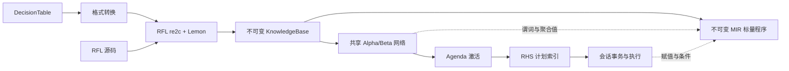

# Core 字符串、解析与执行边界

本文说明 `core` 的字符串所有权、统一解析前端、RETE/RHS 的 MIR 标量执行、
SessionPool 和失败边界。对外安装的 C ABI 保持原声明；内部 C++ 类型不是安装
接口。下面的设计约束描述当前实现，测量数据按日期单独记录。

## 发现与选择

- **HIGH，已修复**：旧 SessionPool 创建失败时跳过槽位；归还时创建失败又尝试 reset，且
  reset 失败仍重新发布。现在要求完整创建，失败直接传播；返回事务失败保留原
  借用，旧会话不进入可用队列。
- **HIGH，已修复**：旧默认 fire_all_rules 会吞掉 RHS 执行错误。两种现有 firing 名称现在
  都在事务回滚后传播错误；失败不会触发 after_rule_fired 或继续后续规则。
- **MED，已修复**：旧决策表有第二套正则/字符串语法，失败后整表改走 RFL parser。移除
  第二套编译器，统一前端；未知 directive 和非法 salience 均失败，不生成默认值。
- **MED，已修复**：旧 RHS lexer 复制源码和普通 token，并串行比较关键字。改用 re2c、源码
  切片和转义字符串的独立 tstr 所有权。
- **MED，已修复**：旧 LHS/RHS 重复比较数学函数名称；比较已有字符串还调用 scalar_text
  生成副本。现在用共享函数枚举分派、固定两项数值参数区和比较期借用视图。



决策表转换器借用不可变表及模板，转换结束前来源必须存活。主语法补齐原决策表
接受的文本 and/or、括号约束、大小写逻辑/比较词、否定裸布尔字段和裸算术右值。
裸布尔字段生成 bool 字面量。NOT 使用主语法的 nested_patterns 包装表示，后续
统一由已有 AST transformer 降低；不再维护第二种 raw AST 形状。

历史 DirectTableCompiler 名称保留，成功计入 parser_path_success；旧 direct 与
按失败原因分类的计数恒为零。计数属于编译线程，避免并行构建 KB 时的数据竞争。

## 字符串所有权

| 数据 | 存储与失效边界 |
|---|---|
| lexer 源码 | 借用同步 parse 调用的完整 std::string；调用返回前有效 |
| 普通 token | string_view 指向源码，不单独复制 |
| 转义 token | lexer 的 OwnedText/tstr 持有；追加新的 token 不移动已发布字符存储 |
| 编译后动作、任意业务字符串 | 继续拥有自身数据，可越过 parse 调用和 Fact 复制边界 |
| interned key | 字典持有不可变 tstr；rehash 不移动字符存储 |
| ScalarTextView | 借用既有字符串；UUID/日期等格式化结果由比较作用域临时持有 |
| 编译期字段路径和表达式切片 | 在加载/编译调用中同步借用；持久 PathSegment 仍拥有名称 |
| 规则执行入口 | KB 处理继承后赋予 RHS 计划索引，OR 终端共享所属规则的计划；激活直接索引 |

OwnedText 是唯一所有者，不可复制；append 会使旧 view 失效，输入不得与自身存储
重叠。StringInterner 维持既有进程级生命周期；clear 要求所有借用者静默。这次
没有把它改成 generation 字典，也不声称解决了跨多次热重载的全局字典滞留。

InternedKeyMap 的有序连续存储保留：F 个字段的查找 O(log F)、插入 O(F)。需要
字段槽位时，应先定义不可变 type layout 与失效协议；当前 API 允许字段集变化，
不能直接缓存可移动的 vector 下标。没有为消除分支引入新的全局服务定位器。

ExpressionDescriptor 删除无人读取的 sanitized 表达式/名称副本；整数文本使用
from_chars，浮点文本通过独立 C numeric locale 的 strtod_l／_strtod_l 转换，
临时终止文本由 OwnedText/tstr 持有。区分非数值、越界和非有限值，不改变宿主
全局 locale；整数越界直接失败，不再重试为 double。

## Agenda 身份与生命周期

**HIGH／事实**：旧 TerminalNode 将规则地址和 token 地址 XOR 后直接作为 agenda
map 的唯一键。不同对象对可以得到相同值，map 赋值和 remove 会影响另一条待执行
项；更换哈希函数只能降低碰撞概率，不能证明身份唯一。

选择 session 持有的单调 activation ID。terminal 内存保存 token → ID，首次
ASSERT 分配并入队，重复 ASSERT 保持原 ID；RETRACT 使用保存的 ID 取消再删除
映射。已触发 token 的映射仍保留至 RETRACT，重新 ASSERT 获取新 ID，旧队列项
不能命中新激活。无条件规则也由同一 session 分配器取号。

session 的单一 owner 线程负责网络传播、取号、入队、触发与撤销；不会新增跨线程
写方或全局分配器。agenda 复制 Activation，规则由不可变 KB 拥有，token 和事实
继续遵守既有 session/pool 借用契约。队列保持 salience 优先；相同 salience 按新
ID 的 recency 排序，业务选择应使用明确 salience 和规则中的 rank 约束，不能依赖
内存地址。内部历史字段 hash_value 保存 ID，对外 C ABI 不变。

ID 上限为 size_t 最大值，到达上限抛出 overflow_error，不环绕或重用；失败由现有
网络一致性／RHS 事务边界传播。reset 先清理 agenda、网络内存和 TMS，再重新
priming；计数不回退，事务失败也不回收已使用 ID。销毁要求 owner 已静默。terminal
entry 数与原有 token 集合相同，每项增加一个 size_t；本次不改变现有 queue 容量
或引入性能收益声明。回滚必须整体回退该网络内存布局及匹配二进制。

回归验证覆盖多规则／多事实的精确触发集合、部分执行后撤销、后续新事实及 reset，
并保留 fraud、tracing、boiler-room 和 mock 决策重放的现有完整行为验证。

## 失败与池状态

SessionPool 的槽位状态为 available → borrowed → returning → available。
returning 失败回到 borrowed，错误向上传播；没有“带病回池”。槽位地址在构造后
不变，队列只发布可用槽位。创建替代会话可能执行 priming 回调，必须在池锁外；
归还提交与失败撤销由互斥和 RAII 保护。销毁前，所有借用者和等待线程必须结束。
SessionGuard 析构无法返回错误；需要处理归还失败的调用方应使用显式 release。

事务回滚、C ABI/结果回调的异常到状态码转换，以及 ContinuousSession 已有且有界
的 committed-operation 重建协议继续保留。它们不会把失败返回为成功。不能把
“fail fast”解释为删除清理、算术校验或跨 ABI 的异常边界。无效 regex 的 admission
直接传播标准库构造错误，不再先转换成另一种“不支持”判定。

## SIMD 的实测选择

现有发布 SDK SaltsBase 0.1.8 的公开 SIMD API 面向 128 位操作，不是批量字符串
比较接口。正式 text_compare_benchmark 比较 string_view、Base vstr 和逐块调用
load/compare/reduce 的 SIMD 实现：5 个样本，每样本 10000 次，半数相等，半数仅
末字节不同；覆盖 4、16、64、512、4096 字节，逐次改变输入并加入编译器屏障。

[2026-11-16 快照](#benchmark-snapshot)包含三种实现的同负载结果。本机的逐块公开
API 路径更慢，因此 core 比较继续借用 string_view，关键字使用 DFA。结论仅对应
这里的逐块实现、输入和平台。若后续 SDK 提供批量字节接口，应在同一基准重新比较。

## RETE 的结构与后续边界

现有网络已有结构化节点缓存、共享 Alpha/Beta、HashedJoin、独立会话内存和 RHS
Command 计划。HashedJoin 与非等值 CrossProductJoin 是构造时的算法选择；值类型
分派、空集合和短路控制仍需要分支。分支数不能证明这些设计不存在。

标量表达式现由下面的 MIR 程序替代递归字符串解释。字段路径提前解析；绑定表、
global 和脚本结果仍由原 owner 解析，不将可变化的容器下标或 Fact 地址固化进代码。
变量按动态标量标签检查类型，没有把全部 DataBind 布局硬编码进 JIT。输入读取和
返回业务字符串仍可能复制拥有型值；不宣称实现了全路径无分配或整引擎吞吐提升。

## MIR 表达式编译决策

本轮以 MIR 替代 core 标量表达式的逐次字符串解释。候选为继续字符串解释、预解析
字节码、调用 Toad、直接生成 MIR。选择直接 MIR：保留 RFL 的整数、空值和字段
语义，不经过 Toad NUMBER 转换；复杂脚本仍由已有 Toad CALL 承担。MIR 使用共享
vcpkg-cache 已恢复的 mir-jit 包及 MIR::MIR，不复制源码或新增依赖下载入口。
mir-jit 1.0.0#3 的 MIT 许可随根 THIRD_PARTY_NOTICES 一起分发；平台资格仍以本
项目正式测试为准。

协议：表达式在加载阶段解析成有界操作和变量访问描述，然后生成原生函数。程序
拥有 MIR context、代码、字面量与字段路径；规则/节点共享不可变程序，会话同步
调用。编译与销毁独占该 context，执行时不调用 MIR API。程序持有者必须覆盖执行
期；不在全局缓存永久保留代码，也不在共享程序中保存当前 Fact/Session。

每个表达式最多 256 个操作、64 个不同变量、64 层语法嵌套、16 KiB 源码；超限在
加载时明确失败。每次求值使用固定容量栈帧，变量按短路路径延迟读取，缓存仅在该
次调用内有效。输入/结果视图不越过调用；输出恢复为拥有型 ConstraintValue。
整数加减乘使用检查溢出的 MIR 指令，浮点运算检查除零及非有限值；比较保留
int64/uint64 身份，整数与 double 比较先检查可转换范围，不先将整数舍入为 double。
除法、数学函数及含 uint64 的算术维持浮点结果契约；纯 int64 加减乘保持精确整数。
运算遵循通常优先级，同级二元算术左结合；修复旧字符串求值器的右结合和整数
经 double 再转回的精度问题。不支持的函数及语法在加载时失败；缺失字段仍按
既有 LHS 契约不匹配，已提供但类型不符的算术输入现在失败，不再静默不匹配。

本轮 Windows LLVM-MinGW 验证中，首轮 helper 捕获方案仍产生 libunwind 诊断，
因此已移除对 JIT 异常栈展开的依赖。生成代码在需要变量、比较或数学函数时返回
显式 host request；C++ 完成该操作后，以保存在帧中的 continuation 继续执行。
每个请求对应原程序的已编译节点，不是失败重试或换用解释器；不重复执行之前的
节点。重复变量直接读取本次调用的缓存，未访问的短路分支不会发请求。
原生代码仅调用不分配、不抛错的缓存读取、truth 和 finite helper；可能抛错的
resolver、类型转换、文本格式化和数学函数只在 C++ 栈上执行，错误直接传播。
RHS 边界把标量类型/domain 错误转换成既有 ReteExecutionException/runtime_error，
保留会话回滚契约。MIR 自身不可恢复的内部错误沿用上游 fatal 契约，不以另一个
执行后端掩盖。

非 RHS 的网络传播、批量 flush、事件时间更新或 query 节点刷新可能已更新部分
状态再抛错。RAII 失败作用域将现有 is_consistent 置为 false；后续 firing、query
和事实变更明确拒绝，不返回成功或 0 次 firing。调用方保留借用事实的生命期，
直到显式 reset 或销毁会话；失败操作不承诺逐项撤销。reset 清空工作内存/索引后
重新 priming，失败仍保持不一致。RHS 内由原事务 owner 回滚，成功回滚的会话
继续可用。字段变更 hint 的借用由 RAII 清理，不在抛错后留下悬空指针。

RETE 节点、连接索引与 RHS 事务仍由原 owner 管理。旧规则快照保留旧程序直到其
使用者退出；回滚仍由会话执行。回退发布应整体回退代码和二进制，不新增运行时
fallback 开关。测试覆盖解析、数值边界、短路、错误传输、并发、生命周期、RETE
与 RHS 集成；基准分开记录编译和重复执行成本，C++ 算术仅作成本参考，不作为
旧解释器的替代基线，不预先承诺吞吐提升。

MIR 的重复调用和整个程序生命周期在[同一 benchmark 快照](#benchmark-snapshot)
中分别列出。前者包括帧初始化、变量读取和结果恢复；后者包括解析、降低、编译、
一次求值和销毁。单表达式源/节点上限不等于 MIR 分配器或进程的 RSS 硬上限。

上游契约：[MIR API](https://github.com/vnmakarov/mir/blob/master/MIR.md)。

## Benchmark snapshot

### 2026-11-16：执行环境与结果

- 平台：Windows 11，AMD Ryzen 9 7940HX，16 核／32 逻辑处理器。
- 配置：LLVM-MinGW x64 Release；`llvm-mingw-x64-release-user`，
  `BUILD_TESTS=ON`、`BUILD_BENCHMARK=ON`。
- 依赖：vcpkg-cache 0.1.3、SaltsBase 0.1.8、SaltsUtils 0.1.4、Toad 0.1.3；
  triplet 为 `qigao-x64-windows-llvm-mingw`。
- 测量对象为当时的工作区内容，未建立已提交 revision 之间的性能对照。
- 完整构建成功；通过 CTest 按 `benchmark` 标签串行执行，**7/7 通过**，
  0 失败、0 跳过，CTest 总墙钟时间 0.97 s。
- 本地原始输出为 `build/benchmark-results.log`，JUnit 为
  `build/benchmark-results.xml`。它们是忽略目录中的本机产物，复现命令可重新生成。

下表摘录该次运行的均值。数值对应源码定义的工作量和计时边界；每批时间与均摊
每次时间分开标明，不能直接把 ops/s 当作完整应用的请求吞吐。

| CTest suite／测量项 | 样本与每样本工作量 | 均值 |
|---|---|---|
| `fact_rule_benchmark.engine`：简单规则批处理 | 10 × 1000 事实 | 654.350 μs／批 |
| 同 suite：alpha 算术表达式批处理 | 10 × 1000 事实 | 766.250 μs／批 |
| 同 suite：RHS insert 批处理 | 10 × 1000 输入事实 | 1054.740 μs／批 |
| `agenda_benchmark.engine`：添加／弹出 | 各 1 × 10000 操作 | 80.930／113.290 ns／操作 |
| `token_pool_benchmark.engine`：Pool 创建及回收 | 10 × 10000 token | 14.967 ns／token，按批均摊 |
| `string_map_benchmark.engine`：InternedKeyMap 查找 | 5 × 40000 字段查找；每 map 4 字段 | 11.728 ns／查找 |
| 同 suite：unordered_map 查找 | 相同工作量 | 14.020 ns／查找 |
| `scalar_program_benchmark.engine`：`$x * 3 + 7` 热调用 | 5 × 10000 次 | 249.094 ns／次 |
| 同 suite：整个程序生命周期 | 5 × 10 次 | 0.638072 ms／次 |
| `continuous_session_benchmark.engine`：周期 watermark 接入 | 10 × 1000 事件；批大小 100 | 1818.530 μs／样本，均摊 1.818530 μs／事件 |

`text_compare_benchmark.engine` 每项为 5 × 10000 对输入，半数相等、半数尾字节
不同；以下单位均为 ns／比较：

| 长度（字节） | string_view | Base vstr | Salts SIMD 逐块 API |
|---:|---:|---:|---:|
| 16 | 5.712 | 5.952 | 12.638 |
| 4096 | 102.472 | 101.698 | 2282.194 |

### 计时与推论边界

- Fact/rule 批处理包含创建/销毁会话、插入事实和 firing；KB 构建位于这些计时段外。
  一批输入事实数不等于实际激活数。比较不同规则时还需对齐命中数和副作用。
- TokenPool 数值包含该计时块中的 Pool、Fact 和临时容器准备/销毁；它不是孤立
  create_token 指令的耗时。字段查找只测四字段 map，不能推广到任意字段规模。
- MIR 冷路径数值包含销毁，不是单独的编译耗时。C++ 算术 reference 仅为成本参考，
  不代表旧解释器。未测量同环境、同负载的旧 revision，不能据此计算提速倍数、
  编译成本盈亏平衡次数或整引擎性能提升。
- ContinuousSession 数值包含会话、事件准备、push、acknowledge 和 watermark，
  表示这个有界工作负载的均摊成本，不是单事件端到端延迟或 MQTT/Modbus 性能。
- Agenda 当前每项只有一个计时样本；其他项按上表采样。这是一次本机运行，未验证
  固定亲和性/频率下的重复性，也未进行其他平台、sanitizer 或生产负载测量。
- 此次只执行 7 个 benchmark。最近一次 CLI 迁移后的非 benchmark 回归为 57/57，
  见本地 `build/cmdparser-full-ctest.log`，当时 `BUILD_BENCHMARK=OFF`。本次结果
  不表示在 benchmark 开启后又执行了一遍当时全部 64 项 CTest。此后新增七类业务
  示例并完成 79/79 全量回归，记录见[场景验证](../SCENARIOS.md#recorded-verification)；
  后一次正确性验证不替换此处基准快照的数值或采样口径。

### 复现

先按根 [README](../../README.md#build)恢复匹配 SDK 环境。使用现有开关，不修改
presets，也不新增测试子集开关；每条命令成功后才执行下一条：

```powershell
cmake --preset llvm-mingw-x64-release-user -DBUILD_TESTS=ON -DBUILD_BENCHMARK=ON
cmake --build --preset llvm-mingw-x64-release-user --parallel 3
ctest --preset llvm-mingw-x64-release-user -L '^benchmark$' -j 1 -V --no-tests=error `
  --output-log "$PWD/build/benchmark-results.log" `
  --output-junit "$PWD/build/benchmark-results.xml"
```

全部构建目标保持在原 graph 中，CTest 标签仅选择本次执行的基准。进行新旧对照时
使用相同编译器、SDK、配置、输入与计时边界，分别保留原始日志和样本数。

## 内部目录与编译单元

`core/include` 与 `core/src` 按同一职责路径组织；只有头文件的模块保留在 include，
私有求值声明和 profiling counters 声明放在 src。这些均为 DLL 的内部实现，
下游仍使用安装的 `rules_forge.h` 和 `RulesForge::RulesForge`：

| 目录 | 归属 |
|---|---|
| model | 值、事实、Token、约束、规则模型、解析结果与事实类型注册 |
| text | 拥有型文本、interned key、比较期借用视图 |
| memory | 事实／会话 arena 与 Token 存储 |
| runtime | KB、session、议程、工作内存、查询、TMS 与运行期回调 |
| execution | RHS 计划和执行、谓词及聚合计算 |
| script | Program、catalog、类型化值和 provider 服务契约 |
| diagnostics | 错误、日志、追踪、指标及 RETE profiling |
| rete | 编译网络、节点族与会话网络内存；compiler/nodes 细分编译和传播职责 |

原布局把脚本、执行、诊断都放在 engine，并以一个 rete_node.cpp 拼接七个 .inc。
保留大文件会继续隐藏编译依赖；按每个方法拆文件又会分散同一节点的实现。
本次选择按节点族拆分 base/join/transform/query 的头文件与独立 .cpp，
复用 src/rete/detail 中的私有求值声明和实现；累加器局部 helper 留在 transform
实现内。共享 profiling counters 仍只有一份定义，不因拆编译单元复制状态。

模型实现从 rfl_rete_defs.cpp 按 value_types、constraint_types、fact、token、
parsed_rule 分离。既有内部 rfl_parser target 组装这些模型源一次，engine 显式
依赖该 target；不新增安装库或业务配置开关。公开 include 根仅暴露内部声明；
src 的私有 helper 路径不再经 parser 的 PUBLIC include 传播。

目录调整不修改既有模型／运行期类的名称、命名空间、算法、状态所有者、输入格式或
C ABI。跨节点私有 helper 归入 rulesforge::rete_detail。仓库中的
parser、C ABI 实现、provider、测试、benchmark 和内部示例同步更新 include 路径；
保留原测试入口与名称。未使用的两层 rfl_rete_defs 转发头随模型拆分移除，
不保留猜测旧路径的兼容入口。需要回滚时整体恢复路径映射、编译清单和引用，
不能只恢复旧文件名。跨翻译单元的优化取决于现有编译配置，本次不承诺性能收益。

Windows LLVM-MinGW x64 Release 完整构建与正式 CTest 79/79 通过，包含七个
benchmark。重构前后 rules_forge.h 的 SHA-256 相同，DLL 的 121 个导出名称集合
相同。日志为本地 build/core-layout-{configure,build,focused-ctest,full-ctest}.log，
JUnit 为 build/core-layout-full-results.xml。未验证其他平台或 sanitizer。

## 验证入口

```powershell
cmake --preset llvm-mingw-x64-release-user -DBUILD_TESTS=ON -DBUILD_BENCHMARK=ON
cmake --build --preset llvm-mingw-x64-release-user --parallel 3
ctest --preset llvm-mingw-x64-release-user --output-on-failure --timeout 180
ctest --preset llvm-mingw-x64-release-user -R '^text_compare_benchmark' -V
ctest --preset llvm-mingw-x64-release-user -R '^(scalar_program_test|scalar_jit_test|scalar_program_benchmark)' -V
```

使用已恢复的发布 SDK 环境；没有修改 presets，也没有新配置开关。验证范围是
Windows LLVM-MinGW x64 Release；未进行其他平台、sanitizer 或整应用性能剖析。
