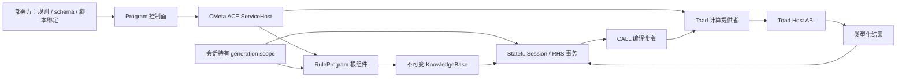
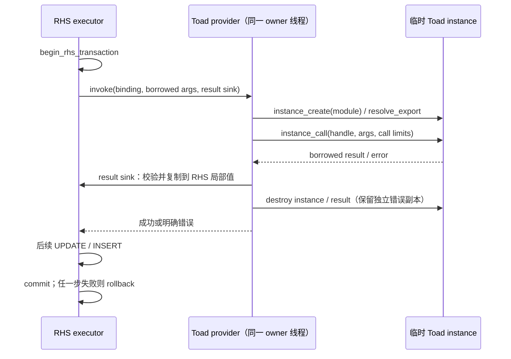

# Toad RHS 计算与 ACE 生命周期设计

状态：首版 stateful Program 已实现，2026-11-15。本文保留架构决策及验收边界；
实际配置、支持范围和使用方法见 [Script Programs](../SCRIPT_PROGRAM.md)，
公开契约以 `rulesforge/include/rules_forge.h` 为准。

## 目标与范围

RETE 负责模式匹配、约束、agenda 和触发；Toad 执行 RHS 中的复杂计算，返回类型化
结果；RulesForge 继续拥有事实、RETE 传播、TMS 和 RHS 事务。ACE 负责提供者组装、
代际发布和作用域，Plugin 负责原生模块租约与卸载。

首个完整交付支持：多个独立 `.toad` 文件、显式命名导出绑定、同步计算、结果参与
后续 RHS、失败回滚、固定会话代际，以及通过正式 SDK 装配的 ACE 提供者。
不在本次设计中引入第二套匹配器、调度器或容器框架。

脚本输入是部署方可信代码。首版不向脚本提供网络、文件、动态原生插件、定时器、
任务启动或事实变更能力。远程用户提供的不可信代码需要独立进程隔离方案。
外部业务动作通过普通输出事实交给宿主处理，详见“外部副作用”。

## 事实基线与必须解决的边界

下表记录实施前工作区的差距及接入 owner；CALL、值适配和 Program 生命周期已在本轮接通。

| 证据 | 实施前行为与接入点 |
|---|---|
| [RhsActionType / CompiledAction](../../core/include/model/rhs_actions.hpp) | 有 UPDATE、INSERT、控制流等，没有脚本调用；需新增 CALL 编译动作 |
| [RhsBackendPlan](../../core/include/execution/rhs_backend_plan.hpp) | 当前为 C++ action plan；CALL 作为其中一种命令，不增加整套替代 RHS 后端 |
| [RhsExecutor::execute](../../core/src/execution/rhs_executor.cpp) | begin → actions → commit，异常走 rollback；脚本错误必须穿过这一边界 |
| [StatefulSession](../../core/src/runtime/stateful_session.cpp) | 拥有事实事务、执行重入 guard 和一致性状态；fire_activation 对部分 ReteExecutionException 可记录后继续 |
| [ConstraintValue](../../core/include/model/value_types.hpp) | 拥有型 C++ variant，含 uint64、UUID、Money、Decimal 和集合；不能无损地统一转 double |
| [KnowledgeBase](../../core/include/runtime/knowledge_base.hpp) | 现有 native predicate 是字符串参数/结果接口；不能代替类型化 RHS 计算接口 |
| [公开 C API](../../rulesforge/include/rules_forge.h) | session 要求调用方串行化；只有连续会话明确要求固定线程；引入 Toad 后的 Program session 需要明确固定 owner 线程 |

正式依赖基线为 vcpkg-cache 0.1.3、SaltsBase 0.1.8、CMeta 0.1.7、SaltsUtils 0.1.4、
CNet 0.1.12 和 [Toad 0.1.3](https://github.com/qigao/TurboScript/releases/tag/v0.1.3)。
Toad 原始 SDK 的 `toad-sdk-manifest.json` 指向源提交
`c4cb667b90fac23902afa76fcdfb6540dd34a889`、producer run `43666836727`。

接口依据是恢复的 CMeta 0.1.7 公开头文件 `cmeta/configurator.h`、
`cmeta/service_host.h`、`cmeta/service_host_provider_abi.h`、`cmeta/plugin.h`，
以及上述 Toad 发布归档内的 `include/toad/script.h`。使用当前的 `CMeta::ACE`、
`CMeta::Plugin` 和 `Toad::Script`；历史技能中的 ComponentPlugin target 名称不作为依据。

- HIGH / 事实：Toad Host ABI 的 module 依附 context，export handle 依附 instance。
  控制线程生成的 module/handle 不能直接交给执行线程使用。
- HIGH / 事实：Toad instance 可保留全局状态。RulesForge 的事实事务没有恢复该状态的
  能力；复用有状态 instance 会让失败后的下一次计算依赖未回滚数据。
- HIGH / 事实：ServiceHost 最多附着两代；scope pin 住服务和提供者代码，但不让服务
  自动具备并发调用能力。复制 descriptor 或 scope 不能产生额外租约。
- MED / 推论：每次新建 instance 可隔离计算状态，代价是初始化及导出解析成本；
  未做消费方测量，不能宣称优于复用方案。

## 模块与所有者



| 状态 / 资源 | 唯一 owner | 生命周期 |
|---|---|---|
| 发布准入、代号和 scope 计数 | ServiceHost runtime | Program 创建至 close、全部 drain、destroy |
| 规则、schema、脚本字节及绑定快照 | generation bundle | 构建开始至该代 drain 完成；快照建立后不再从文件系统读取 |
| KB、编译规则和 CALL 绑定编号 | RuleProgram 根组件 | 属于一代，只读；不得原地替换 |
| 动态提供者模块和代码 | Plugin registry / ServiceHost module lease | 所有依赖对象销毁后才可释放并卸载 |
| Toad context、已编译 modules | 提供者的 session runtime | 在会话 owner 线程创建、使用、销毁 |
| 临时 instance、export handle、result | 一次 invoke | 调用完成或失败时销毁，不跨 CALL 保留 |
| Facts、Token、agenda、TMS、事务 | StatefulSession | 延续现有归属，脚本只能看到值 |
| 结果局部变量 | 本次 RHS 执行帧 | 当前词法作用域结束或 RHS 退出 |

RuleProgram 是宿主内的静态 Configurator 组件，显式 requires 计算服务。
Toad adapter 作为原生 provider，通过当前 `salts_service_host_provider` 契约发布
绑定，由 Plugin 装载；配置、Interface 和依赖使用 canonical CMeta 描述。
一个 provider 实例可以服务多个脚本绑定。`.toad` 由 Toad 编译，不能交给 DSO loader。

宿主只在取得 scope 后查找该代根服务；根服务提供同代 KB 和计算服务关联。
不维护独立的“当前 KB”和“当前脚本”指针，不在业务执行期间查询全局服务定位器。
generation backing storage、配置快照及 scope 均地址稳定。

## 部署输入与两阶段准入

沿用 DataBind 处理独立的 JSON bundle 描述；它与 RFL 语法分开。实际字段名和
限制见使用指南。描述包含规则/schema 文件、提供者路径、执行模式、资源限制，
以及下列显式绑定。示例是配置内容的逻辑形状，不是已实现的加载格式：

| binding | module | export | 参数 | 返回 |
|---|---|---|---|---|
| pricing.calculate | scripts/pricing.toad | calculate | amount: int64, tier: string | record(total: int64, discount: int64) |
| risk.score | scripts/risk.toad | score | events: list(int64) | int64 |

binding 名唯一，module/export 区分大小写；同一 module 可以有多个 export。
签名是 RulesForge 的参数/结果 schema。Toad 0.1.0 export info 只提供名称和 arity，
不能据此宣称已静态验证返回字段或完整参数类型。值在调用前和返回时严格验证。

1. 控制面串行读取部署描述和引用文件，形成有界、不可变快照，记录内容 SHA-256。
   相对路径以 bundle 所在目录为基准，规范化后必须属于显式部署目录；原生 provider
   也由部署方显式选择。拒绝重复绑定、缺失类型、未知字段和超限输入。
2. 通过 Plugin/ServiceHost 构建候选 Configurator 图。Toad provider 在控制线程完成
   activate 时创建临时 context，注册完整的只读/纯计算能力集合，然后编译全部
   module、创建验证 instance、解析全部 export、核对 arity 和所选后端是否支持。
   此 context 及其所有对象在控制线程销毁；只保留源字节、签名和绑定编号。
3. 依赖已验证 provider 的根组件构建 KB 和 CALL 计划；所有静态可判定错误在发布前
   失败。部分创建失败按逆依赖次序清理。候选失败不改变当前已发布代。
4. 会话 acquire scope 后，在自己的 owner 线程创建 context，注册同一能力集合，
   从该代快照重新编译 modules，并做实例化/导出准入。成功后才返回可用会话。
   OOM、平台后端拒绝等仍可能在此失败；不把控制面验证当作运行时创建成功的保证。

首版文件间不使用隐式 include/import 搜索，不做运行时文件发现，不拼接源码。
多个文件通过独立绑定供 RHS 调用；同一文件中的命名 helper 可复用算法。
当前 provider 在编译前只接入 bundle 的 `native_modules` 明确列出的 CMeta Function
模块，没有公开的通用 callback 注册入口。每代拥有稳定地址的独立 registry；所有
Toad context 的 lease 释放后才能卸载。完整的准入、并发及失败协议见
[Script Programs](../SCRIPT_PROGRAM.md#application-defined-native-computation)。
未知 import、动态绑定名及发布后注册新能力均拒绝，不切换旧 SDK 或其他后端。

## RHS 语言与编译计划

采用显式 CALL 命令和只读局部结果，保留现有 UPDATE / INSERT 作为事实变更入口。
以下为已实现的 CALL 语法；假定 Order 字段及签名已由部署 schema 声明：

```rfl
rule "Calculate order price"
when
    $order: Order(status == "NEW")
then
    call "pricing.calculate"($order.amount, $order.tier) into $price
    update $order { total = $price.total, discount = $price.discount, status = "PRICED" }
end
```

- CALL 保存已验证的 binding 编号、参数求值计划、结果 schema 和局部槽位编号。
  不保存 instance handle；执行时不做全局名称搜索或读文件。
- 增加 `RhsActionType::CALL` 和其明确的数据成员；沿用 C++ action plan 的顺序、
  分支和循环 lowering。没有 CALL 的现有规则行为保持不变。
- `into` 必需；结果只读，不是 Fact，不允许 UPDATE / RETRACT / INSERT_LOGICAL
  把它当作事实句柄。参数初版支持 schema 已知的字段、字面量和已定义局部结果；
  不把现有数值表达式 evaluator 扩展成通用脚本解释器。
- 结果名不得覆盖 fact binding、global 或当前可见局部名；只在 CALL 成功后的同一
  词法作用域可见。分支/循环内的结果不逸出作用域；每次迭代有独立局部帧。
  解析与语义分析拒绝未定义变量、错误参数数量及静态可判定的类型不符。
- 使用专用参数 lowering，不复用现有“整个 `$fact` 变为 fact ID”的赋值规则。
  首版不接受整个 Fact、FactList 或 Token 作为参数，只传显式字段值。

## 计算服务与调用时序

提供者公开一个 canonical CMeta Interface，逻辑操作为创建 session runtime、invoke、
销毁 session runtime。跨 DSO 使用 C opaque handle、Toad 的类型化 view 和明确
长度，不传 `std::variant`、STL、异常或 allocator 所有权。不新增版本化接口族、
手写平行 vtable 或重复 registry；复用已发布 Plugin/ServiceHost ABI。

invoke 接收 binding 编号和 borrowed 参数 view，通过宿主 result sink 同步交付
borrowed 结果。sink 在返回前完成 schema 验证和深复制；provider 随后销毁临时
instance/result。sink 的失败使 invoke 失败；C 边界两侧捕获各自 C++ 异常并转为
明确错误，不跨 DSO unwind。诊断写入调用方有界存储，保留原 Toad status/phase。



每个 CALL 新建 instance，不复用其全局状态；复用的是 owner context 上已编译的
module。销毁也可能写 result，因此必须先复制结果/诊断再清理。若后续 RHS 失败，
没有隐藏脚本状态需要回滚。跨调用业务状态必须显式存在于输入/输出事实中。

context 的能力注册在编译前完成并冻结。首版只注册经过明确准入的纯函数；
context 使用 bare 初始化和显式拒绝原生插件的 authorizer，不能依赖默认 allow-all。
验证实际 Host instance 的可达 builtin 和 import 行为；若存在绕过 host 注册的
I/O、任务或加载入口，则是准入阻塞，不能靠“未注册 callback”声称已隔离。
callback 不得保存参数 view、进入同一 session 的任何变更入口、嵌套 fire/reset/
destroy 或同步递归进入 Toad。准入失败在状态修改前返回错误。
Toad 错误导致的 instance 不再复用，清理失败必须保留尚未释放的所有权并阻止卸载。

## 数据结构与值协议

保留现有 Fact / ConstraintValue 和已使用的容器。SaltsBase 提供 UUID、已有内存池
等基础能力；CMeta::CSTL 已用于其所属模块；DataBind 提供签名/schema 与部署描述。
适配层直接构造 Toad view，不经过 JSON，也不把整套内部容器迁移为 CSTL。

首版值集合如下；不在集合中的类型在签名准入时失败，不静默字符串化：

| RulesForge 值 | Toad 表示 | 约束 |
|---|---|---|
| NilValue | NULL | 仅 nullable schema 允许 |
| bool / int64 | BOOL / INT64 | 精确类型匹配，不把 bool 当整数 |
| double | NUMBER | 只接受有限值；不用于 Money/Decimal 隐式转换 |
| string | STRING | 长度明确、合法 UTF-8；不依赖 NUL 结尾 |
| uint64 | INT64 | 首版仅接受 <= INT64_MAX；更大值显式失败，不截断或转 double |
| UuidValue | STRING | Base 标准 UUID 文本；按 UUID schema 验证并恢复，不猜测普通字符串 |
| DecimalValue | RECORD(mantissa: INT64, scale: INT64) | scale 必须可表示为 int32，遵守字段 schema；无隐式浮点换算 |
| MoneyValue | RECORD(amount: Decimal record, currency: STRING) | 验证币种和金额 schema；算法的精度、舍入与溢出由业务契约明确 |
| TypedList | ARRAY | 按元素 schema 递归，限制深度/节点数 |
| 字符串键 ValueMap / 结构结果 | RECORD | 唯一 UTF-8 key；只接受 schema 允许的字段，不以顺序匹配 |
| FactList、ValueSet、非字符串键 map、Bytes、Enum、Date/Time/Duration、BigInt | 首版不支持 | 签名拒绝；后续扩展必须定义可逆表示及正式测试 |

uint64 参数 schema 可以存在，但每次调用还须做值域检查；声明覆盖全 uint64 范围的
绑定不满足本 profile，应在部署准入时拒绝。Decimal/Money 的记录编码只保证
传输可逆，不赋予脚本任意精度计算能力；需要精确算术时使用经过验证的纯 host
能力，不能用 double 计算后强转回整数。

输入递归展开到调用帧拥有的稳定 view 存储，叶子字符串仅借用当前不会修改的
字段/局部值。构造完成后不再移动 backing storage。视图在 invoke 返回时失效。
共享容器只读遍历，检测循环并按节点/深度计费；不能由脚本获得可修改的别名。
结果递归验证和深复制，禁止把 Toad view 放进 Fact 或局部槽位。

同一 producer 和 consumer 为一个 session owner，严格串行，无新队列、锁自由结构
或跨线程 payload。多个 session 各有 context，能够在不同线程运行。首版有脚本的
session 从创建到销毁固定线程；不得把“外部加锁”当作 Toad owner 迁移协议。

## 资源、取消与失败

部署描述显式提供正值限制：脚本总字节、文件/绑定数、AST/exports、同代会话数、
每 context 内存、instance retained/stack/globals、输入/输出字节、值深度/节点、
每 CALL 的 steps/loops/recursion/host callbacks。单位遵循对应 SDK 字段；adapter
额外对输入 view 与复制结果分别计费，不能只限制结果。

所有乘加、计数累加和窄化转换在操作前检查。默认值若提供，只在 schema 一处定义，
不在 CMake/presets 中增加选项。达到容量立即拒绝；不等待其他会话释放、不扩容
绕过上限、不自动重试。两代驻留成本必须分别计入部署预算。

容量估算为 `generation snapshots + Σ(session contexts + compiled modules +
call views + copied result + live instance)`；乘以并发会话数时使用 checked arithmetic。
这不是硬 RSS 保证：除非上游证明所有分配都受对应 policy 覆盖，否则仅声明已验证
的对象/字节配额。内存峰值及实例初始化成本由实际消费方测试/测量决定。

Toad 0.1.0 的 call options 含协作 interrupt；这只约束其覆盖的 call safe points，
不等于 RETE 总预算、硬 CPU deadline 或抢占 native callback。实例初始化和编译的
保障必须单独验证，不能把 instance_call 的预算套用到整个生命周期。
首版只接收可信部署脚本；需要可中断初始化、全执行 deadline 或硬隔离而 SDK
不能证明支持时，应拒绝该保障要求，记录上游阻塞，不修改已发布 SDK 或构建 HEAD。

| 失败边界 | 返回/处理 | 状态影响 |
|---|---|---|
| 配置、编译、导出/arity、类型不支持 | COMPILATION_FAILED，保留文件/绑定/Toad phase | 候选销毁，当前代不变 |
| 会话创建失败 | SESSION_CREATION_FAILED；OOM 使用 MEMORY_ALLOCATION | 不返回半初始化 session，scope 在依赖对象清理后释放 |
| 容量/配额/两代限制 | RESOURCE_LIMIT | 不执行超限步骤，不自动重试 |
| CALL 类型、运行时、sink 或 callback 错误 | 传播至 RHS rollback，再由 C 边界返回错误 | 本次规则的事实变更回滚；此前提交的规则不回滚 |
| 回滚失败 | SESSION_INCONSISTENT | 拒绝继续 fire，遵守现有恢复/销毁契约 |
| wrong thread / reentry / 关闭后准入 | 入口错误，保留具体诊断 | 在访问 Toad 或改变事实前拒绝 |
| 清理 / scope release / drain 失败 | 原错误及清理错误均保留，显式失败 | 保留未清理 owner，不卸载仍被引用的代码 |

以上错误名采用现有 `RULES_FORGE_*` 状态，不新增脚本专属版本化状态族；具体 C 函数
文档逐项固定返回值。运行时脚本错误不得使用会被 fire_activation 吞掉的异常路径，
不得在 C wrapper 清空 last_error 后返回 OK。只在最终消费/转换边界记录一次诊断，
包含 generation、规则、binding、module/export、原始 status/phase 和位置；不输出参数数据。
资源拒绝和 drain busy 保留计数及在途数用于排障，不假定已有导出指标。

## 外部副作用

首版 CALL 只计算，不直接执行 HTTP、DB、设备命令或发送消息。需要这些动作时，
Toad 返回计算结果，RHS INSERT 业务请求事实，宿主在 fire 成功后消费请求。
宿主自行提供业务幂等键，完成后插入成功/失败事实供后续规则处理。

请求事实与本次 RHS 一起回滚；已经执行的外部动作无法依赖这一事务撤销。
内存中的请求事实也不是持久 outbox，不承诺跨进程 exactly-once。持久交付、重试、
去重和异步完成是宿主能力，进入后续设计前必须确定其 owner、容量及真实终态。
连续会话存在回放，未验证确定性与交付去重前，不开放脚本驱动的外部动作。

## 发布、热更新与关闭

ServiceHost 是唯一发布点。候选 bundle 包含同代规则、schema、脚本和 provider 配置；
构建成功后 publish。新 session acquire 新代，旧 session 持有原 scope，继续使用旧代。
同一 session 不在两次 fire 之间偷偷切换脚本；不迁移旧事实或重用旧 activation。

两代附着已满时拒绝第三代发布；旧 session 不释放就不能完成旧代 drain。
不强制驱逐会话、不修改现有 scope，也不通过旁路存储无限保留旧代。
回退是部署方显式用旧内容构建更大代号的新候选，不复用较小 generation ID；
同样受两代限制。发布失败后保留当前代是原子发布语义，不是自动失败 fallback。

关闭分为：停止新会话/新发布准入 → 现有 owner 完成在途 CALL → owner 销毁
instance/result/modules/context → 销毁 session → 释放 scope → drain generation
逆序停止组件和释放 ObjectRef → 释放模块 leases → Plugin stop/quiesce/unload →
销毁 runtime/backing storage。ServiceHost close 本身不会取消或销毁已有 scope。
不得从控制线程强行销毁其他线程的 Toad 对象；close/drain busy 返回给调用方处理。

## 公开入口与兼容性

已向现有 `rules_forge.h` 增加一个 opaque `ruleforge_program_t`，承载上述部署
runtime；不公开 C++ 内部对象或 ACE struct，不改变现有 KB/session struct 布局。
下表省略公开函数的 `ruleforge_` 前缀；完整参数、返回值和所有权以头文件为准：

| 入口 | 输入、输出与所有权 |
|---|---|
| program_create(bundle_path, out_program) | 同步校验/发布初代；成功返回调用方拥有的 Program，失败输出为空 |
| program_reload(program, bundle_path) | 控制面串行，构建完整候选并显式发布；失败不改变当前代 |
| program_create_session(program, out_session) | 在执行线程取得 scope、完成 owner runtime 准入后，返回现有 session handle |
| program_close(program) | 撤销新会话和 reload 准入，已有 session 可完成/销毁；关闭为终态，不重开 |
| program_destroy(program) | 要求已关闭且会话/在途操作归零，完成 drain 后释放；busy/清理失败保留 handle 所有权 |

Program 的控制操作由调用方串行化；会话准入可与 reload 竞争，但只能取得完整旧代或
完整新代，Program close 的准入由宿主生命周期锁保护；destroy 要求调用方排除所有并发 Program API 调用。
现有 session_destroy 必须识别 Program session 的固定线程和执行中状态，错误前不释放
任何资源。同步 C 接口只借用路径至返回；所有输出 view 均不泄漏到外部。

普通无脚本 KB 的加载入口继续工作，不隐式加载配置或启动 ACE。遇到 CALL 却没有
Program 绑定时在加载边界失败，不能忽略 CALL。首个公开交付支持 stateful Program
session；continuous 的 replay、恢复和结果边界必须另由其正式测试证明后才开放入口。

## 候选方案与取舍

| 方案 | 判断 |
|---|---|
| 延用字符串 native predicate | 所在层是 LHS，丢失类型/精度，所有权不适合 RHS；不采用 |
| 只静态链接 Toad，不用 ACE | 最小计算接入可行，但不满足显式 provider 生命周期及代际发布目标 |
| 每个脚本编译成一个原生 DSO | 增加编译/部署成本，脚本更新与原生 ABI 耦合；不采用 |
| 一个 provider，多个绑定，每次独立 instance | 采用；清晰隔离事务外状态，接受初始化成本，后续优化需消费方证据 |
| 共享跨线程 context / 原地替换脚本 | 违反 Toad owner 与 RETE/KB 一致性边界；不采用 |

新增消费依赖只有正式 `Toad::Script`；ACE/Plugin 来自已选择 CMeta SDK。
Toad first-party 为 Apache-2.0，完整分发需保留其 LICENSE/NOTICE/THIRD_PARTY_NOTICES，
并核对实际 payload 的 MIR 等依赖及动态库闭包。不能从 Script target 很小推断分发
体积或安全面很小。SDK 只有四个已发布 profile；其他 triplet 没有正式资产就阻塞。
发布生产者成功不替代本仓库的 ABI、内存、线程或漏洞审查；不声称“没有安全问题”。

首版热更新对象是 bundle 内容，同一进程固定一个匹配的 Toad/Base/CMeta 运行时闭包。
升级这些 SDK 通过完整构建和重启部署，不承诺同时加载不同 Toad ABI。原生 provider
若需要换代，必须使用不同的不可变部署路径并验证 OS loader 的模块身份及同一 SDK
闭包；禁止覆盖正在加载的 DLL/so/dylib，不能把复制相同路径当作新模块已载入的证据。

## 实现顺序与验收

1. **依赖与值适配**：通过现有恢复入口增加精确 Toad 发布校验、匹配 profile、原始
   manifest/producer/摘要及共享 cache 回执；使用 `Toad::Script`，保留 upstream notices。
   不改 presets/common helpers，不增加模块或诊断开关，不源码构建上游。
2. **内部完整计算链**：parser、语义分析、CALL lowering、值 bridge、独立 instance、
   RHS 回滚与错误传播一起交付正式测试；未接通公开入口前保持内部不可见。
3. **ACE 与部署闭环**：根组件/provider canonical ABI、候选验证、scope/session 绑定、
   两代发布、失败清理及关闭协议；同一 graph 构建真实 provider fixture，不能用 mock
   loader 代替实际 DSO 生命周期验证。
4. **公开 Program 与示例**：公开全部已验收入口及其参数/错误/所有权文档，更新 DSL、
   用户指南和现有 `examples`。没有完成线程准入、回滚和 unload 证明前不发布。

正式测试继续由能力 owner 注册，TinyTest + CTest：

| 测试归属 | 必须证明的行为 |
|---|---|
| core/parser/tests | CALL 语法、arity、未知 binding、值/事实作用域区分、分支/循环局部逃逸拒绝 |
| core/test/engine | 两文件不同导出、CALL→UPDATE 再匹配；失败前已有 UPDATE/INSERT/RETRACT 的回滚；不吞错误 |
| core/test/engine | int64 极值、uint64 越界、UTF-8/NUL、UUID、Decimal/Money、嵌套容器、重复 key、循环、深复制 |
| core/test/engine | 连续调用不保留脚本 globals；一次 CALL 成功但后续动作失败后的再次执行结果一致 |
| core/test/engine | 所有 quota 的 0/1/N/N+1、乘加溢出、OOM、sink 失败、初始化/调用/清理失败 |
| rulesforge/tests | Program C ABI、线程/重入准入、错误码/last_error、输出空值及失败后的 handle 所有权 |
| rulesforge/tests | G1/G2 会话分别执行旧/新算法、第三代拒绝、坏候选不发布、同代 schema/KB/脚本一致 |
| rulesforge/tests | close 与会话创建/reload 竞争、live scope 阻止 drain、owner 清理先于 lease release、实际 DSO unload |

先跑相关正式测试，再用现有 `native-release-user` configure/build 完整 graph、CTest 和
install；按现有 CI 验证已发布的四个 profile，Android 区分交叉构建与设备运行。
使用仓库现有 sanitizer presets 检查越界、悬空 view 和泄漏；可用工具验证并发准入。
不创建独立 consumer/smoke 工程。初始化 safe points、纯能力准入、实际 DSO ABI 和
SDK 支持的资源限制若不能证明，列为交付阻塞，不能靠注释或 marker 检查宣布通过。

迁移只新增显式 Program 部署；现有无脚本规则无需重写。回滚部署使用完整的已验证
旧二进制与配置；新脚本 bundle 不交给不支持 CALL 的旧库。本轮本机 LLVM-MinGW Release 完整构建与 CTest 43/43 已通过；
不把此前 38/38 基线当作新增功能验收。RulesForge 其他平台及 sanitizer 尚未运行。


## 复杂窗口用例补充（2026-11-15）

[预测维护示例](../../examples/maintenance/README.md) 将 DataBind 固定四点波形、
Toad 两遍统计、RETE 最近四条观测、许可关联、成本决策、前向链和 ACE 策略分代组合，
使用现有 stateful Program/C ABI。当前 API 尚未连接 ContinuousSession，选择数量窗口
而不模拟 watermark 或增加新的公开入口；共享窗口样本归 RulesForge，脚本只借用值。
旧会话保留完整旧代，新会话可选择保守策略；不迁移既有 facts。

实际运行暴露了 accumulate 结果约束未传播、静态 IN 集合未比较，以及内联绑定时间戳
被误划入 alpha 的正确性缺口。修复复用现有字段解析和 typed predicates：结果保留
AND/OR 树和短路语义，session-owned result_propagated 只表示是否向下游发布过当前
结果，撤销后再更新/判断。累计源的前序变量由 beta token 和原有 inline 字段映射解析。
没有通过删除约束、放宽业务断言或切换匹配后端让示例通过。

这些修复收紧原本声明的匹配语义；历史错误地激活/漏激活的规则可能改变输出。原有
反欺诈断言与完整正式测试是回归边界，新增内核测试验证阈值进出、逻辑事实撤销、
组合条件、IN/NOT IN 和源/结果算术绑定。部署回滚需恢复旧版库和相应规则包，不能
在新库中添加旧行为开关。本机 Windows LLVM-MinGW x64 Release 已通过正式 Toad
0.1.3 SDK 的解释器与指定 JIT 场景：maintenance 的脚本到原生计算链，以及
script_program 的两文件计算和旧会话 generation 固定。该范围不等于所有语言形式、
ContinuousSession + Toad 或其他平台都已通过；具体断言见
[maintenance 回归](../../rulesforge/tests/maintenance_program_test.cpp)与
[Program 回归](../../rulesforge/tests/script_program_test.cpp)。core 标量 MIR-JIT
与 Toad bundle mode 的边界另见 [core 设计](./core-ownership-and-dispatch.md)。

## 本轮上游修复与发布证据

- HIGH / 事实：旧 Toad 0.1.0 在独立 owner 并发初始化时崩溃于共享 registry 的
  qsort/strcmp。consumer LLDB 栈在忽略目录 build/toad-debug.log。上游改为一次注册、
  registry 变更/查找共用 owner mutex、出锁前复制 entry，未在 consumer 加全局执行锁绕过。
- HIGH / 事实：bare 初始化和 native-plugin authorizer 不构成 ambient builtin 的
  能力限制。Toad 新增默认关闭的 EXPLICIT_CALLS 模块标志；provider 显式启用，
  原生 I/O、import、eval 和动态调用在 lowering 前拒绝。该能力不声称进程隔离。
- 用户明确授权修复并发布上游，再使用正式 SDK。Toad 0.1.1 因缺少发行说明而未完成
  GitHub Release；本次先行上传的 NuGet 0.1.1 已撤回，源码 tag 和已有 0.1.0 保留。
  最终正式版本为 0.1.2，producer 43620027243 四平台构建/测试、打包、发布全成功。
  六个资产的 GitHub digest、SHA256SUMS、四份 manifest 和 NuGet SDK 文件逐字节核对通过。
- 当前首版只接收已声明的值集合；binding arity 和字面量类型在规则编译时检查，
  来自事实/局部结果的数据类型、结果字段及值域在调用边界检查并回滚失败。
  不把这项实现宣称为所有 RFL 表达式的完整静态类型检查。
