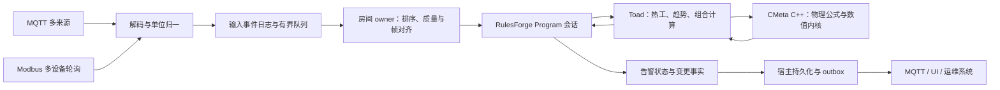
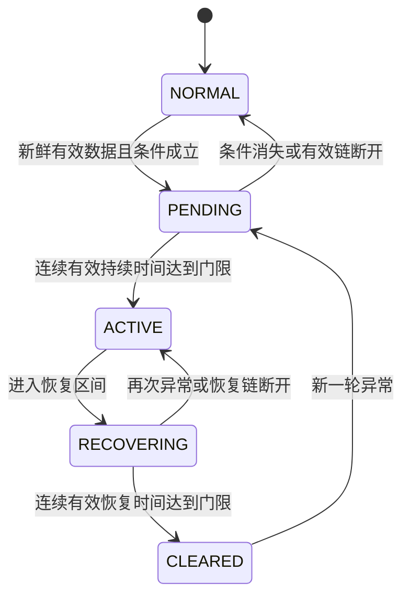

// re2c --lang c
# 锅炉房多源计算与预警用例设计

状态：多线程离线模拟版已实现，运行方式与实际范围见 [README](README.md)。本文保留
后续真实接入和可靠投递的目标设计；尚未连接真实设备或实现持久化 outbox。示例复用
[maintenance](../maintenance/README.md) 的 Program、Toad 0.1.3 和 CMeta 原生函数链。
本文的时长、容量和业务阈值都是演示参数；现场限值与寄存器表必须来自项目设备资料。
范围是只读监测、预警和运维建议，锅炉/燃烧器的保护联锁继续由现场控制系统负责。

## 模拟输入实施协议

首个可运行版本采用九个独立生产线程：两个锅炉 PLC、一个三泵 VFD 寄存器源、
三个振动 MQTT 源、一个双燃气表 MQTT 源、一个母管热量计和一个环境 MQTT 源。
它们各自生成有界的 JSON/寄存器信封，不共享可变随机数或规则对象。

每个源使用 Base 的 spsc_ring，借用通道自有的 32 KiB 字节存储；固定大小信封用
memcpy 传递，读 release 后不保留槽位指针。单 producer / 单 room owner 分工固定。
条件变量只提供满/空等待和取消唤醒；满时阻塞生产，不覆盖旧数据、不自旋扩容。
结束先关闭生产端，owner 排空；异常则取消全部通道、唤醒并 join，之后才销毁存储。

每个源按显式 delivery_time 输出。owner 对九个队头做稳定合并，按相同到达时刻
的一组消息处理后再封存到期帧。源可独立提前生成、独立背压；不使用 sleep 或线程
实际执行顺序来决定业务时间。event_time 可比 delivery_time 旧，用来注入乱序/迟到。
模拟持续时间、去重表、重排缓冲、事实和输出记录均有硬上限，满即报告真实错误。

### 字符串、失败边界与分支职责

`boiler.schema` 是会话数据的事实源，通过已发布 SaltsUtils 的 `salts_idl_target`
生成 CMeta 原生记录和 C++ owner。宿主填写字段，DataBind 完成 JSON 序列化与绑定，
随后通过 `ruleforge_session_add_data_bind_value` 提交；不自行拼接或解析 JSON。
生成记录的字符串由 `tstr` 唯一持有，owner 清理；`vstr` 仅供同步借用。
查询输出的固定标签经 re2c 校验后映射到静态 `std::string_view`，不借用 query 的内存。
re2c 的输入有明确上限和哨兵，要求整个 token 匹配；未知标签立即失败。
去重比较复用 Salts::SIMD，比较声明长度内的字节，尾向量零填充，避免越界读取。
这些改动没有吞吐基准结果，不宣称性能收益。

调度的七份 DataBind 输入全部构建成功后才开始提交。该边界防止绑定失败留下半组
输入，不承诺多次 C API 插入的事务性；插入失败仍直接传播。SDK 0.1.4 的生成文本
转换仅接纳 Message，初始 `WindowEvidence` composite 用 DataBind 直接绑定固定
零值 fixture；未在失败后切换序列化实现。动态快照采用生成的 WindowSnapshot Message。

格式错误、寄存器组不完整、非有限数值均在解码边界失败，保留原始 DataBind 错误；
缺失/过期遥测仍是业务 UNKNOWN。线程启动先完成 owner 构造再创建线程，部分启动
失败由析构取消并 join，不需要 catch/rethrow。线程入口捕获只用于把原始异常送回
owner，进程入口负责非零退出；C ABI 的异常到错误码转换同样保留。脚本字段诊断用
栈上 RAII 路径作用域，在失败点一次形成错误，避免每层重新捕获与包装。

分支数量不是 RETE 是否有效的判据：模拟时间线、协议解析和边界校验各有所属层；
窗口聚合、关联、候选准入、硬约束和最小成本选择属于 RFL 网络，公式属于 Toad/
CMeta 原生模块。固定词汇用生成 DFA，固定线程集合用数组，资源清理用 RAII；
不为消除 if/else 引入服务定位器、通用策略框架或宿主动作选择器。

模拟使用现有 Program 的六个独立会话与显式时钟事实。窗口到期通过 RFL RETRACT
处理，所有 C API/Toad 调用均在 owner 线程。实际 MQTT/Modbus 网络协议、持久化
outbox 和进程恢复属于后续阶段，模拟版不宣称已经验证这些能力。

模拟版实际容量为每源 32 KiB 通道、4 个待发乱序信封、64 个历史样本，最多 240 s
逻辑时长、241 个输出帧、128 个变更记录、8192 个去重项、每泵 30 个窗口事实和
6 个 Program 会话。模拟信封/字段及已实现测试以 README 和代码为准。下文的峰值
流量、1024 项接入队列、180 s 源观测、512 项 outbox 等为后续服务目标，不代表
当前模拟版已实现或压测通过；故障恢复与协议级验收同样属于后续阶段。

### 模拟版的实现取舍

九个源天然是一对一传递，选择已发布 Base SPSC ring，而不是再实现队列或引入新的
调度框架；源级背压和稳定队头合并使结果可重复。单一 MPMC 到达队列也可汇聚线程，
但其入队顺序受线程调度影响，还需要额外重排契约，当前示例没有这个需要。

六个会话分别拥有 B1/B2/P1/P2/P3/ROOM 的状态与窗口，全部由同一个 owner 调用；
跨设备关联由 owner 复制已提交的标量指标后送入 ROOM 会话。这样复用现有 Program
边界，不新增动态分区或跨线程 Session API。公开 C API 没有单条事实删除入口，
窗口到期与输入/输出事实清理使用现有 RFL RETRACT，不扩展公开接口。

改动仅添加独立示例及类型诊断上下文，SDK、依赖入口、presets 与公开 ABI 不变。
回滚可移除 boiler_room 的 examples 子目录注册和新增目录；既有 maintenance 和
Program 使用方式不受影响。未来真实网络/持久化必须独立验收，不能沿用本次结果。

## 1. 场景与输入

### 窗口证据进入调度

实现时用四个 core 正式回归复现了已有嵌套谓词准入缺陷：metrics.ready/tick 等实际
是标量，但原类型查找回退到外层 Object 元数据，导致有效窗口被误判 UNKNOWN。
同时值读取路径仅处理嵌套 FactList，缺少 DataBind ValueMap 的点路径遍历。
值读取补齐 record 遍历，类型查找沿已声明的有限 record 路径取得叶子字段；索引/动态集合保持既有推导，
不猜测未知类型。这个语义修复独立于示例，不能通过宿主展开窗口字段来掩盖。

连续异常回归还复现了聚合来源 OR 被压平为 AND 的缺陷，会把正常帧排除出中断集，
将安静窗口或单个尖峰误判持续异常。含 OR 的来源保留整棵约束树，按左 token/来源
事实评估并去重，复用已有短路谓词执行；纯 AND 保留既有 alpha/join 路径。三个
正式回归覆盖修改/撤回、相关外部绑定变更及两分支同时满足时仅计一次。OR 路径
增加每对 token/来源的判定，不宣称吞吐收益；不能以改变示例口径掩盖错误。

每个泵会话保留 (T-30 s,T] 的 1 Hz 帧事实，包括显式无效帧。RETE 只对有效帧
计算样本数、异常帧数、均值/峰值、前后 15 s 计数/均值，同时记录最近一次中断和
最早帧时间。缺测或低于异常阈值的帧均中断连续异常；epoch 改变时清理旧帧。
Clock 单独推进也触发到期和重算。EWMA 仍仅按新源 ID 更新，与帧窗口分开。

Toad 在 RETE 聚合之上计算覆盖率、保守连续异常秒数和趋势斜率：至少 24/30 个
有效帧且当前输入有效，窗口才可用；趋势另需两个半窗各至少 12/15 个有效帧。
ROOM 按同一 tick 接收三份 WindowSnapshot，RETE 分类为 UNKNOWN、TRANSIENT、
CONFIRMED、DEGRADING 或 NORMAL。连续异常至少 10 s，或多数异常且均值高，属于
CONFIRMED；有覆盖保证的前后半窗上升属于 DEGRADING；单个高峰只形成观察证据。

不完整窗口不能默认视为健康，未确认异常时不建议 DERATE/SWITCH。KEEP 的最优
候选遇到 TRANSIENT 证据时输出 OBSERVE（维持运行并观察，同一个 planId）；当前
风险仍是硬约束，不能用窗口均值稀释危险读数。Toad 风险成本/余量评估保留当前风险，
并纳入窗口均值和受趋势覆盖保护的短期外推；恢复后不会立即抹去已有高风险证据。
候选解释包含分类、覆盖率、峰值、持续秒数与趋势。窗口不足或计算失败的语义仍
分开：前者是不可执行建议，后者传播错误。四个物理方案和生产公开 ABI 保持。

新增 window 场景复用九线程，以相同瞬时峰值对比单次尖峰、逐步恶化、持续异常、
断流及恢复。直接调度测试显式构造历史摘要；默认 DispatchInput 没有已验证历史。
最多增加每帧三份 WindowSnapshot、三份 WindowAssessment，随请求一起清理；不另
建宿主滑动队列或第二份可独立修改的统计状态。移除新增窗口绑定/策略可回滚。

### 约束下的运维方案选择

在既有九源模拟上增加 dispatch 场景。ROOM 会话接收当前帧的三泵快照、已提交的
锅炉热功率及 Toad 天气需求；静态 PumpRoute 表描述实际回路归属和额定参数，
PlanSpec 表描述 KEEP、DERATE、SWITCH、STOP 四类建议。宿主只复制观测与操作输入，
不计算可行性、方案排名或最终动作。跨会话快照在 owner 上复制并按 tick 精确关联。

RETE 将运行泵异常证据与回路拓扑关联，并为每种方案产生一个候选。结构准入先
检查当前数据质量、备用泵连接、可用性和检修锁；通过的候选调用 dispatch.toad。
Toad 计算流量/转速对应的热能力、三次方泵耗电、剩余风险及示例成本。RETE 再按
供热余量与风险限额排除不可执行候选，以 score 最小、planId 最小的顺序确定建议。
不存在可行方案时输出 REQUEST_SUPPORT；脚本/原生函数失败仍传播错误并回滚，
不能转换成业务建议。输出包含四个候选的拒绝原因/指标和相关异常证据。

ROOM 是这组派生事实的唯一所有者，每帧最多一个 request、三个 snapshot、四个
candidate、一个 decision 和三个 incident。复制输出后由 RFL RETRACT 清理，再处理
下一帧；已有告警事实保持独立。Report 最多保存 241 次决策。静态拓扑/方案在会话
初始化时建立，检修状态属于每帧操作输入。新能力复用原有六会话、SDK 和模块加载
协议，不修改公开 C ABI、presets 或依赖。移除新增调度规则/绑定及宿主调用即可回滚。

不采用宿主 if/else 直接返回动作，因为那无法展示多事实约束和候选解释。也不增加
通用优化器：四个离散方案足以验证规则约束与复杂计算分工。代价是仅覆盖固定
拓扑和离散速度，未求解全局连续最优；风险损失和成本系数是明确的演示假设。
建议不会写设备寄存器或改变后续模拟真值，实际切换需单独的执行/联锁协议。

实现中正式回归复现了 agenda 预取问题：一次预取并移出最多 64 个 activation 后，
前一个 RHS 改变匹配条件或插入更高 salience 工作，已移出的后续项仍会执行；仅检查
事实是否仍存活不足以证明匹配仍成立。fire_all_rules 的选择边界改为每次一个 RHS，
每次提交后重新选择，保留已有批量事实接入与 Agenda API。取舍是增加选择次数；
本次保证规则语义，不宣称吞吐收益，后续优化必须保留撤销和 salience 重选回归。

一个燃气热水锅炉房，包含 B1/B2 两台锅炉、P1/P2/P3 三台循环泵和公共供回水母管。
泵与锅炉回路的对应关系由拓扑配置给出，不能仅凭设备名称推断关联。

| 来源 | 协议和演示周期 | 主要测点 | 用途 |
|---|---|---|---|
| B1/B2 PLC | Modbus TCP，1 s | 供回水温度、流量、压力、燃烧器状态、厂家故障位 | 热功率、效率、设备故障 |
| 三台泵的变频器 | Modbus，经 TCP/RTU 网关，1 s | 运行状态、频率、电流、功率、吸入口压力 | 运行一致性、异常关联 |
| 泵振动边缘节点 | MQTT，1 s | RMS、峰值、峭度、轴承温度 | 趋势和异常风险 |
| 独立母管热量计 | MQTT，1 s | 热功率、供回水温度、流量、累计热量 | 跨设备能量核对 |
| B1/B2 燃气表 | MQTT，5 s | 标准状态流量、累计量、计量状态 | 输入功率、累计量一致性 |
| 室外与机房传感器 | MQTT，5 s | 室外温度、机房温度、设备在线状态 | 负荷解释、采集质量 |

MQTT topic 采用 `plant/{site}/{asset}/telemetry/{group}`，状态 topic 独立。
一条消息可带多个同批次测点，但不能混入不同采样时间却不标注的值。例如：

```json
{
  "site":"BR-01", "asset":"P1", "source":"vibration-edge-1",
  "boot_id":"edge-boot-42", "seq":1082, "event_time_ms":1794700800000,
  "quality":"GOOD",
  "values":{"rms_mm_s":2.1,"kurtosis":3.2,"bearing_temp_c":52.0}
}
```

Modbus 配置逐项记录 unit ID、功能码、PDU 零基地址、数量、数值类型、跨寄存器
字序、缩放、单位、轮询组和设备时间/心跳来源。现场的 4xxxx 标号先按设备手册
转换为 PDU 地址，不能在运行时猜测。FC03/FC04 分别用于读取保持/输入寄存器；
寄存器内字节序与设备多寄存器数值的字序分别处理。超时、异常响应、长度或解码
错误生成采集故障，不生成数值零。[Modbus 官方规范](https://www.modbus.org/file/secure/modbusprotocolspecification.pdf)

MQTT 采用 QoS 1 时仍需业务去重；retained 数据可能是历史状态，不能以本次接收
时间冒充采样时间。业务 ID 不使用 MQTT Packet Identifier，也不能只依赖 DUP 位。
这些处理建立在协议交付语义之上。[MQTT 5.0 官方规范](https://docs.oasis-open.org/mqtt/mqtt/v5.0/os/mqtt-v5.0-os.html)

## 2. 模块与所有权



- 采集适配器拥有连接、轮询、协议错误和原始缓冲区。异步回调只提交拥有型事件，
  不访问 RulesForge 或 Toad 对象。传递成功转移所有权，失败保留发送方所有权。
- 每个房间一个 owner 线程，串行驱动六个会话：两个锅炉、三个泵、一个房间汇总。
  各会话只接收所属资产的数据，避免把当前示例的常量过滤窗口误称为通用按键分区。
- RulesForge 会话拥有事实、窗口成员、趋势状态、关联规则及告警状态；宿主拥有
  时间推进和有界到期索引。索引只保存事实句柄/到期时间，不另存可独立修改的指标。
- Toad 执行同步纯计算，每次调用使用新 instance。下一次 EWMA 状态由结果返回并
  在 RHS 中提交，不能隐藏在脚本全局变量中，否则事实回滚不能恢复它。
- CMeta 模块为无可变共享状态的可信原生计算。三个计划模块为 physics、statistics、
  scoring；generation 加载它们，context 在编译前取得 lease，作用域排空后才卸载。
- MQTT 发布、通知发送和持久化由宿主执行。计算过程不调用网络或写 Modbus 寄存器。

## 3. 时间、重复与质量

统一事件包含 `site/asset/source/group/event_id/event_time/ingest_time/time_basis/quality`，
另记录设备启动标识、源序号、轮询周期及点位配置版本。

| 问题 | 明确处理 |
|---|---|
| MQTT 重复或重连重投 | 使用 source + boot_id + seq + group；已见 ID 不再进入统计或趋势更新 |
| 相同 ID 对应不同载荷 | 输入冲突错误并隔离，不能当作普通重复吞掉 |
| 缺少稳定业务 ID | 视为接入契约错误，不用载荷相同来猜测重复 |
| retained 启动快照 | 仅用于状态展示，不当作新采样计入趋势；实时流到达后才准入计算 |
| Modbus 无设备时间 | 标记 POLL_RECEIVE，记录请求起止；不能声称这是精确设备采样时间 |
| 多个寄存器块 | 用 poll_cycle_id 组装；关键块跨度超配置限值则帧不完整，不混用跨周期半包 |
| 设备重启/累计表回退 | 新 boot epoch；跨 epoch 的差分为 UNKNOWN，不能算成负用量 |
| 时钟明显偏移 | CLOCK_SKEW，隔离时间敏感计算；原始数据保留供诊断 |
| 缺测、坏质量或过期 | 值为 null 并携带原因；不能补零、无限沿用旧值或解释为正常 |

演示每 1 s 构造一个计算帧，允许 3 s 乱序。帧 T 在显式时钟推进到 T+3 s 时封存，
只使用采样时间不晚于 T 且仍在新鲜期内的输入。迟到数据只进历史诊断，不重写已
发布的当前告警。Modbus、振动和燃气表的新鲜期分别演示为 2.5/3/8 s，室外温度
为 30 s；各项独立配置，关键测点还要检查跨源时间差。

不同采样速率不能用消息条数代替时间权重。瞬时功率按帧展示，效率告警使用公共
30 s 窗口的水侧能量/燃气输入能量之比；燃气累计量端点、热值及水侧积分必须覆盖
同一时段，覆盖或同步不满足时为 UNKNOWN。不能把一个 5 s 燃气样本复制成五个
“新采样”。趋势状态保存 last_source_event_id，同一输入被多个对齐帧引用时不重复
更新 EWMA。累计表回卷只有在设备契约明确位宽与行为时才能处理，否则报计量故障。

`SourceConnected` 与 `DataFresh` 是两个事实。Broker 在线不代表传感器数据新鲜；
寄存器读取成功也不证明设备内部采样器仍在更新，需结合设备心跳/计数器判定。

## 4. 与当前 Program 的可实现边界

现有 [ContinuousSession](../../docs/CONTINUOUS_RULE_ENGINE_DESIGN.md) 有 watermark、
去重和有界结果协议，但它与 Toad Program 的组合尚未交付。现有普通会话的
`window:time` 测试还依赖系统时钟和插入触发，不能直接当作本设计的确定性时间源。

一期采用显式 FrameTick：宿主按 T 维护 10/30/60 s 的窗口成员，到期时通过已有
事实操作移除成员，并让 RulesForge 对剩余集合做 count/avg/min/max 等聚合。
窗口成员是 Observation 的派生索引事实，不能独立改值；源观测按单独保留期清理。
窗口统一为 (T-W,T]，每个资产在 1 s 网格上最多一个派生帧；无效帧保留质量与时间，
但不计入有效样本。这样数量上限与时间边界一致，而不是将最近 N 个值当作 N 秒。
无新遥测时也必须推进 tick、质量状态和到期处理。这里不依赖新的隐式 watermark
入口，也不同时向一个 ContinuousSession 的内部 StatefulSession 写入数据。

一个周期分三次明确提交：

1. 输入和时间提交：记录帧、过期与数据质量变化。以后计算失败不倒退时间。
2. 资产计算提交：RFL 选择可计算帧，调用 Toad，提交指标和趋势状态；失败仅回滚
   当前 RHS，并由宿主提交独立 ComputeFault，不能伪造正常指标。
3. 房间汇总提交：收齐同一 T、同一策略 epoch 的资产结果后核对能量和组合预警。
   缺少某个结果则汇总 UNKNOWN；不会声称跨六个会话存在一个原子事务。

帧键为 site + asset + T，封存后不再修改。指标、NextTrendState 和已处理帧标记在
同一个 RHS 提交，重复 tick/投递不能再次更新趋势或累计告警。失败帧以独立的
ComputeFault 标记终态；除受控恢复重放外，不隐式重跑同一失败计算。

主要 schema/事实分工如下，具体声明随实现阶段提交：

| 模型 | 内容和事实源 |
|---|---|
| SourceSample / SourceHealth | 源 ID、点值、单位、时间依据、质量与故障，来自采集入口 |
| FrameReady | 固定 T 的不可变计算输入、覆盖率及源事件引用 |
| Observation | 经一次 RHS 提交的资产指标，作为窗口主数据 |
| WindowMember | 窗口键、Observation 引用及投影值，有界派生事实 |
| TrendState | EWMA、方差、有效样本数、last_source_event_id，由 RHS 原子更新 |
| AlarmPolicy | 工况门控、阈值、滞回、时长、策略 epoch，由已验证配置提供 |
| AlarmState | 活动阶段、occurrence、revision、确认与有效链时间，唯一业务写入者为会话 |
| AlertTransition | 不可变变更和证据快照，由宿主投递 |
| AckRequest | 带 expected_revision 的操作输入，过期确认明确拒绝 |

每条变更最多内联 32 个源事件 ID；更大窗口以输入日志的有界位置范围和摘要引用，
不在活动 AlarmState 上无限追加证据。持久化投影与 checkpoint 由提交记录派生，
不能作为另一条独立修改业务告警的路径。

## 5. 计算与绑定

计划中的脚本和原生分工如下，函数名只是目标设计，尚未实现：

| Toad 模块 | 输入/输出 | CMeta 原生标量函数 |
|---|---|---|
| thermal.toad | 锅炉帧 + 工况模型 → 热功率、燃气输入功率、效率与质量 | boiler_heat_kw、boiler_efficiency_pct |
| pump.toad | 泵帧 + 既有 TrendState → 风险指标和 NextTrendState | boiler_ewma_alpha、boiler_risk_index |
| balance.toad | B1/B2 指标 + 独立母管表 → 偏差、完整性与证据 | boiler_balance_pct |
| advisory.toad | 有效窗口汇总 + 负荷模型 → 运维建议和解释 | 复用上述标量函数 |

RHS 只传 schema 约束的字段/嵌套值，不传 Fact 指针。签名字段显式出现，缺测使用
nullable 值和质量字段，不用 optional/default 来改变当前计算签名协议。
Toad 组织 record/list、条件与组合逻辑，C++ 只接收抽取后的标量，返回标量。
不向 Toad 0.1.3 的 scalar Plugin 路径传数组、record 或 OUT 参数；计划原生函数均
少于 16 个 IN 参数。时间保留为 int64；原生公式使用明确单位的相对秒数，避免把
epoch 毫秒塞进平台宽度不同的 C long。

### 热功率与效率

演示模型固定水密度 ρ=1000 kg/m³、比热 cp=4.18 kJ/(kg·K)，仅用于可重复测试：

```text
P_water_kW = ρ × cp × flow_m3_h × (Ts_C - Tr_C) / 3600
P_gas_kW   = gas_flow_Nm3_h × LHV_kWh_Nm3
eff_pct    = 100 × P_water_kW / P_gas_kW
gap_pct    = 100 × (P_B1 + P_B2 - P_header) / (P_B1 + P_B2)
```

实际密度/比热模型以及燃气标准状态和热值口径由项目确认。不同标准状态的体积
不能直接相加；未确定 Nm³ 的温压基准与热值口径时，效率不可计算。分母为零、
停机/启动过渡或数据不同步时输出 UNKNOWN，不能钳成 0%/100%。数值溢出或非
有限结果必须失败；长期不合理效率生成计量一致性告警，不能直接诊断传感器损坏。

正常帧的可核算例子：B1 流量 18 m³/h、温差 20 K，输出 418 kW；燃气流量
48 Nm³/h、LHV 9.7 kWh/Nm³，输入 465.6 kW，效率约 89.78%。B2 流量
14 m³/h、同温差时输出约 325.11 kW，两台合计约 743.11 kW。

### 泵趋势与复合风险

EWMA 使用真实相邻有效采样间隔：α=1-exp(-Δt/τ)。Toad 返回新的均值和方差，
方差下限来自模型校准。初始化样本不足或采样间隔过长时重新进入基线采集，不能
通过极小分母放大风险，也不能把一次设备重启当作快速物理变化。

风险综合振动偏离、峭度变化、电流波动、吸入压力下降和流量波动。分数定义为
0–100 的演示指标，不当作校准概率。只有振动异常时给出部件异常线索；振动、
压力和流量共同异常时才生成“疑似循环不足/汽蚀”建议，并附上所有来源证据。

## 6. 预警规则

以下均为演示策略。设备安全限值读取已确认的设备模型，不在本设计填入生产设定值。

| 告警 | 跨源条件和门控 | 演示持续/恢复策略 |
|---|---|---|
| TELEMETRY_STALE | 必需点过期、采集故障或时钟失配 | 连续 5 s 警告；恢复需连续新鲜数据 |
| EFFICIENCY_DEGRADED | 稳定运行且负荷足够；效率较同工况基线低 7 个百分点 | 60 s；恢复至差值低于 3 个百分点并保持 60 s |
| HEAT_BALANCE_MISMATCH | 同帧锅炉总输出与独立母管表偏差超过 8% | 30 s；低于 4% 保持 60 s |
| PUMP_COMPOSITE_RISK | MQTT 振动与 Modbus 电流/压力/流量共同异常 | 风险 ≥80 保持 20 s；低于 40 保持 60 s |
| PUMP_RUN_MISMATCH | 命令运行、频率有效，但流量/电流与工况不一致 | 10 s；禁止仅凭 run 位判正常 |
| HEAT_SUPPLY_DEFICIT | 室外负荷模型的需求与有效供热量持续不匹配 | 120 s；模型/室外数据无效则 UNKNOWN |
| PLC_REPORTED_FAULT | PLC 厂家故障位有效且源序列新鲜 | 直接状态告警，不等待统计窗口；不发送控制指令 |
| CIRCULATION_INCIDENT | 同回路泵复合风险与房间能量偏差同时活动 | 一条关联事件，保留子告警，不把相关性写成确定诊断 |

维护模式作为显式事实，只影响配置允许的运维通知，不伪造恢复状态。现场报告的
关键故障独立展示。每条告警保留：原始 event IDs、poll cycle、frame T、计算值、
单位、质量、规则 ID、策略版本、原生模块标识以及阈值/持续时间的解释。

## 7. 告警生命周期



`acknowledged` 与物理状态正交：确认不等于恢复，恢复也不能抹掉尚未确认的历史。
ACTIVE 期间缺测保留活动状态并标记 stale，不能自动清除；PENDING/RECOVERING
只累计连续、有效的时间。20 个 1 s 帧不必然代表已经持续 20 s，应使用事件时间差。

稳定键为 site + asset + alarm_code，不包含 generation，避免重载制造第二条活动
告警。每次复发增加 occurrence，每次状态变化增加 revision；通知 ID 包含二者。
确认命令指定 occurrence 和 expected_revision，旧确认不能确认新一轮故障。
持续异常只发一次 ACTIVE，之后仅升级、恢复或按配置周期发送有界摘要。

## 8. 确定性演示故事

下面时间均为帧事件时间，普通融合结果在 T+3 s 封存后才能产生；不是墙钟即时保证。

| 时间 | 注入数据 | 必须观察到的结果 |
|---:|---|---|
| 0–30 s | 正常 Modbus、燃气与振动输入 | 基线采集；没有“数据不足即正常”的判定 |
| 30–59 s | 两锅炉约 743.11 kW，母管同值 | 正常指标；效率和能量核对可复算 |
| 40 s | 重复 MQTT 和历史 retained 包 | 不新增采样，不重置趋势，不刷新旧采样时间 |
| 60 s | P1 振动升高，Modbus 吸压/流量共同异常 | P1 进入 PENDING |
| 65 s | 独立母管表与支路总输出持续偏差 15% | 能量核对进入 PENDING |
| 80 s | 泵异常仍在且输入有效 | PUMP_COMPOSITE_RISK ACTIVE，只有一次首次通知 |
| 95 s | 偏差持续 30 s | HEAT_BALANCE_MISMATCH ACTIVE；形成关联事件 |
| 100–119 s | P1 振动节点停止更新 | 新鲜期届满后失效；5 s 后采集质量告警，原泵告警不清除 |
| 110 s | 运维确认当前泵告警 | acknowledged=true，异常仍为 ACTIVE |
| 120 s | 遥测恢复，风险与能量偏差进入恢复区间 | 恢复计时从有效帧开始 |
| 130 s | 收到事件时间为 64 s 的旧包 | 进入迟到诊断，不反转当前恢复进度 |
| 180 s | 恢复区间持续满 60 s | 泵/能量偏差清除；保留 occurrence、确认及关联事件历史 |

另外独立注入零燃气量、计数器回退、Modbus 半包/异常、原生函数非有限返回、通知
失败和进程重启。不要把这些错误混入上述时间线后仍断言恢复时间保持不变。

## 9. 有界运行与可靠投递

演示按正常 20 个 envelope/s、120 个点值/s 规划，峰值 200 envelope/s 持续 3 s。
这是假设和验收输入，不是已测吞吐。单消息最多 8 KiB、32 点；单房间最多 128 点。

| 资源 | 演示上限 | 满/失败行为 |
|---|---:|---|
| 接入队列、重排区 | 各 1024 个拥有型 envelope | 显式背压/拒绝并产生 overrun；不能静默丢弃或无限扩容 |
| 去重表 | 8192 项，300 s | 不驱逐仍有效条目来掩盖满；暂停新准入并报告容量故障 |
| 源观测 | 180 s，六会话合计最多 1080 帧 | 显式到期；不能把窗口退出当作所有源事实自动删除 |
| 10/30/60 s 窗口成员 | 六会话最多 600 项 | 到期移除派生成员，保留主观测的独立生命周期 |
| 未投递变更 | 512 项 | DELIVERY_BLOCKED，停止新计算准入、保留记录并报告阻塞，不能宣称告警已送达 |
| Program session | 每代最多 8，正常使用 6 | 超额拒绝；两代同时存在的预算另计 |

20×300 + 200×3 = 6600，是去重表容量估算的保守输入。两队列载荷上限为
2×1024×8 KiB = 16 MiB，另有对象、索引、事实和运行时开销；这不是进程 RSS 限制。
迟到/处理滞后仍按时间契约判断，队列有剩余容量不代表数据仍可用于当前控制帧。

可靠通知分两阶段：RF 提交告警变更事实，宿主再持久化 transition + outbox + 已处理
输入位置，持久化后才发送。存储失败发生在 RF 提交之后时，不谎称事实已回滚：房间
进入 DELIVERY_BLOCKED，保留提案，按明确持久化协议进行有界、幂等重试。该恢复
属于投递协议，不重跑有副作用的脚本。

重启从已持久化位置恢复并重放输入，通知使用稳定 transition ID。告警 ACK、策略
切换和 tick 也属于可重放输入。MQTT PUBACK 只证明对应协议链路进展，不证明业务
持久化或人工确认。日志/存储介质与客户端 ACK 边界需要独立选型和正式崩溃测试；
当前仓库没有可据此宣称可靠投递完成的持久化 outbox。

持久化启用时，日志空间、保留期和最早可回收输入位置也必须显式配置。仍被恢复
位置或告警证据引用的数据不能静默回收；空间不足进入可观察的阻塞/拒绝状态。

## 10. 策略升级与关闭

一期使用 generation pin：既有会话继续原策略，新会话使用新策略，不宣称窗口或
AlarmState 自动迁移。在线接管是后续明确能力：房间在帧边界暂停，导出有界业务
事实，使用同一 owner 建立新代并校验恢复；单一协调者决定接管，失败保留旧代。
不得复制 Token/RETE 内存或跨线程转交 Toad context。原生 DSO 采用不同不可变路径。

关闭顺序：停止采集准入 → 处理/明确拒绝已入队事件 → 完成或报告未持久化提案 →
关闭六个 session 的 instance/module/result/context → 释放 scope → drain generation →
停止并卸载原生模块/销毁 registry。无法完成的清理必须报告真实失败，不能抢先卸载。

## 11. 实施顺序与验收

1. 离线确定性回放：先定义数据/schema/单位、显式 tick、归一化和质量契约；
   无真实网络、不使用 sleep，完整复现第 8 节故事并逐条核对告警变更。
2. Program 与计算：实现 .toad、CMeta 标量模块、窗口成员和告警状态机；通过现有
   正式 CTest 入口验证计算、RHS 回滚、按资产隔离和内存上限。
3. 协议接入：MQTT/Modbus 适配器共用同一个规范化入口；使用协议级服务器/设备
   模拟器验证重连、重复、retained、字序、缩放、半包、异常与断线。MQTT/Modbus
   客户端库与 TLS/现场访问配置在这一阶段确定，不先复制下载或连接框架。
4. 可靠交付与恢复：实现宿主持久化及 outbox，做 RF 提交前后、持久化前后、MQTT
   发布前后各崩溃点测试，再验证连续运行、资源上限、时钟偏移和通知积压。

验收必须包括：相同输入重放得到相同 transition ID；别的锅炉/泵不污染窗口；迟到包
不清除新告警；缺测不判正常；窗口过期无需等待下一条遥测；原生调用失败回滚；
旧 occurrence 的 ACK 被拒绝；投递重试不制造第二次 ACTIVE；无效候选策略不替换
当前 generation；崩溃恢复不重复对外效果。性能目标单独测量，真实设备验证与离线
回放结果分别报告。

当前已实现多线程模拟采集、到达/事件时间对齐、显式窗口到期、五个 Toad 模块、
三个 CMeta 模块、告警/确认状态机及带约束/成本解释的四方案调度建议。
协议级适配、持久化 outbox、恢复和在线状态迁移
仍待实现。基础入口为 [Script Programs](../../docs/SCRIPT_PROGRAM.md) 和 maintenance。
