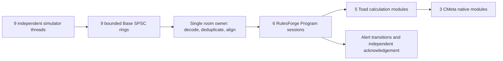

# Boiler room: nine simulated sources, RulesForge and Toad

This runnable example models two gas boilers, three circulation pumps, a header
heat meter and outdoor temperature. Each input source has its own thread. No
broker, PLC, credentials or physical equipment is needed. The numerical limits
are demonstration parameters, not equipment protection settings.



## Build and run

Restore the released SDKs and load their environment as described in the
[root README](../../README.md#upstream-dependency-versions), then run from the
repository root:

```powershell
cmake --preset llvm-mingw-x64-release-user -DBUILD_TESTS=ON
cmake --build --preset llvm-mingw-x64-release-user --parallel 3
ctest --preset llvm-mingw-x64-release-user -R '^boiler_room' --output-on-failure
ctest --preset llvm-mingw-x64-release-user -R '^boiler_room_demo\.example$' -V
ctest --preset llvm-mingw-x64-release-user -R '^boiler_room_dispatch\.example$' -V
ctest --preset llvm-mingw-x64-release-user -R '^boiler_room_window\.example$' -V
```

`llvm-mingw-x64-release-user` inherits release defaults with `BUILD_TESTS=OFF`.
Pass `-DBUILD_TESTS=ON` when configuring this preset for CTest; otherwise no tests
are registered and CTest reports `No tests were found`. Each configure/build/test
command must select the same preset and build directory. The existing
`native-release-user` preset already enables tests and can also run this example.

The default scenario runs 185 seconds of **logical time** as quickly as the
calculation permits. Thread scheduling and `sleep` do not drive business time.
The `window` CLI scenario runs 240 logical seconds to include evidence rebuilding.
For another scenario, use the same built executable and bundle:

```powershell
& ./build/llvm-mingw-x64-release-user/bin/boiler_room_demo.exe `
  ./build/llvm-mingw-x64-release-user/examples/boiler_room/bundle/bundle.json inefficient
```

The CLI accepts `normal`, `circulation`, `inefficient`, `cold`, `dispatch` and `window`. Invalid arguments,
configuration, script/native calculation failures and exhausted bounds fail with
a nonzero exit code. The CTest suite additionally injects malformed payloads,
conflicting IDs, meter restart, native formula failure and producer failure.

## Inputs and concurrency

| Thread/source | Simulated representation | Period |
|---|---|---|
| B1 PLC, B2 PLC | Separate Modbus-style register snapshots: supply/return temperature, flow, pressure, fault bits | 1 s each |
| P1–P3 VFD | One coherent 15-register poll cycle: frequency, current, pressure, flow and run bit for each pump | 1 s |
| P1, P2, P3 vibration | Separate MQTT-style JSON messages: RMS and kurtosis | 1 s each |
| B1–B2 gas meters | JSON cumulative volume and instantaneous rate for both boilers | 5 s |
| Header meter | JSON heat power | 1 s |
| Outdoor sensor | JSON temperature | 10 s |

Source identity, boot epoch, sequence, event time and explicit delivery time are
envelope metadata. JSON uses the DataBind `Payload` schema in `simulation.cpp`;
the fixed eight-value array has source-specific positions declared by
`make_message`/`Decoder`. These are simulation formats, not a real device register
map or an MQTT topic contract. Boiler flow is signed; register scaling is 0.01,
except fault/run bits. The scenario uses degC, m3/h, kPa, A, mm/s RMS, Nm3 and kW.

Each source exclusively owns the producer endpoint of a 32-KiB Base `spsc_ring`.
The owner copies a complete envelope before releasing a read slot. Full channels
block producers; cancellation wakes both endpoints. Every producer is joined
before channels, codecs or rule sessions are destroyed, including error paths.

The owner merges source heads by delivery time and source index. Frame T closes
after all messages delivered at or before T+3 s. Only samples at or before T can
contribute. Freshness limits are 2.5 s for Modbus, 3 s for vibration/header, 8 s for
gas and 30 s for ambient temperature. Missing or stale readings have explicit
validity flags and never expose an older good sample. Malformed JSON, incomplete
register groups and non-finite decoded values stop the simulation with the
original decoding error; they are not converted into successful bad-quality
frames. The demo prints unavailable final metrics as `null`.

Transport injections include duplicate IDs at 40 s, a 2-s delay at 45 s, retained
startup snapshots and a unique event from 64 s delivered at 130 s. Equal IDs with
different payloads are errors. Retained messages never update trends; events for
sealed frames are counted as late and cannot change published alerts. Producers
remain independent when P1 vibration stops from 100 through 119 s.

## What each layer contributes

`salts_idl_target` generates the native CMeta records and C++ owners from
`boiler.schema` using the released SDK's `salts-idlc`. The owner fills typed
records, lets DataBind serialize and bind them, then submits immutable
`DataBindValue` objects through the C API. No host JSON concatenator or parser is
used. The fixed initial composite `WindowEvidence` fixture is parsed directly by
DataBind because SDK 0.1.4 admits generated native text conversion for Messages.
All seven dispatch inputs are bound before the first fact is submitted; later
session insertion failures still propagate and do not imply batch atomicity.

Generated records own their `tstr` fields; the C API copies bound values before
the owner releases them. Report labels are validated by a generated re2c lexer
and refer to static string literals through `std::string_view`, so they survive
query/session destruction. re2c recognizes fixed labels and scenario names;
DataBind handles JSON. Salts SIMD compares the exact byte ranges used for
duplicate-payload detection, with a zero-padded final vector and no overread.
This refactor makes no measured throughput claim.

- **Host owner:** normalization, bounded identity/history storage, arrival/event
  alignment, 30-s water-energy integration, six session lifetimes and output copying.
- **RulesForge:** joins to model/policy/state facts; explicit-clock expiry via
  `RETRACT`; average/max over the retained pump-risk window; transactional state
  updates; transition and acknowledgement-result facts, drained after copying.
  In `dispatch`, topology/evidence joins, structural admission, heat/risk
  constraints and minimum-cost selection also live in RFL.
- **Toad:** thermal calculation orchestration; EWMA state evolution; cross-sensor
  risk scoring; weather-demand calculation; alert hold times, hysteresis,
  occurrence/revision and acknowledgement decisions; counterfactual plan metrics.
  Each invocation is stateless;
  state enters as arguments and is committed by the RFL RHS.
- **CMeta native modules:** `physics` supplies heat/efficiency/balance formulas,
  `statistics` supplies the EWMA coefficient and checked integer state conversion,
  and `scoring` supplies the demonstration composite risk formula. `physics` also
  supplies the cubic pump-power curve. All are passive,
  pure scalar functions admitted through `Toad::PluginABI` and loaded by Program.

Heat power is `rho * cp * flow * (supply - return) / 3600`. B1's normal
18 m3/h and 20 K produce **418 kW**. Efficiency compares water kWh integrated
over [T-30 s,T] against the gas cumulative-volume difference over the same interval
times 9.7 kWh/Nm3: about **89.7766%** at 48 Nm3/h. Both gas endpoints must be valid,
exactly aligned and in one boot epoch. Between 5-s gas updates, an already valid
efficiency may be retained for at most 8 s; a new epoch invalidates it immediately.

Pump EWMA uses `alpha = 1 - exp(-dt/30 s)` and updates once per source event ID.
The risk combines RMS excess above the commissioned 2 mm/s baseline, pressure
drop from 150 kPa and flow drop from 18 m3/h. Thirty new samples warm up the
trend. After a gap longer than 10 s the trend warms up again; valid readings below
the physical recovery threshold can still start alert recovery immediately.
Window mean/peak use valid, equally spaced **frame** observations, not duplicated
MQTT deliveries. Invalid frame markers remain in the bounded window and break
continuous exposure; their numeric placeholders never enter the mean or peak.
Expiry is explicit event time, independent of the system clock.

Toad 0.1.3 lowers some scalar arithmetic through floating-point numeric slots.
Scripts therefore retain integer state in records, use checked native conversion
for counter arithmetic, and assign literal booleans at typed result boundaries.
The RulesForge schema validator continues to reject implicit type coercion;
diagnostics now identify nested field paths and argument positions.

## Default fault story

| Logical time | Result |
|---|---|
| 60 s | P1 vibration rises while VFD pressure/flow fall; risk enters pending |
| 65 s | Independent header meter shows a 15% heat imbalance |
| 80 s | `P1/PUMP_COMPOSITE_RISK` raised after a 20-s hold |
| 95 s | `ROOM/HEAT_BALANCE_MISMATCH` raised after 30 s; `CIRCULATION_INCIDENT` correlates both active alarms |
| 100–119 s | P1 vibration stops; P2/P3 and all other sources continue |
| 108 s | `P1/DATA_STALE` raised after freshness expires and a 5-s hold |
| 110 s | Current occurrence/revision acknowledged; stale revision rejected; physical fault remains active |
| 120 s | Measurements recover; physical recovery holds begin |
| 125 s | P1 data-stale alarm clears |
| 130 s | Old event is counted as late; recovery is unchanged |
| 180 s | Pump risk, heat imbalance and their correlated incident clear |

`inefficient` independently raises B1 efficiency degradation at 90 s, following
the first complete energy window and a 60-s hold. `cold` independently raises a
weather-driven heat-supply deficit at 120 s. Neither requires a pump fault.

## RETE windows are decision evidence

Each pump session owns its `(T-30 s,T]` frame facts. RETE computes valid/elevated
counts, mean/peak, counts and means for the two 15-s halves, the last break and
oldest frame timestamps. Toad derives coverage, conservative continuous exposure
and trend arithmetic from those aggregates; the host copies the owned summary
into ROOM without maintaining another statistical queue.

The policy is a `WindowPolicy` fact, shared from one example configuration source:

| Evidence | Demonstration contract |
|---|---|
| Usable window | Current input valid, at least 24/30 valid frames, last valid frame at most 2.5 s old |
| Usable trend | Usable window plus at least 12/15 valid frames in each half |
| Elevated frame | Risk at least 40 |
| Continuous exposure | Elapsed time since the first eligible elevated frame after the last low/invalid frame, bounded by retained history |
| `CONFIRMED` | At least 10 continuous seconds, or at least 15 elevated frames and mean at least 40 |
| `DEGRADING` | Covered trend with recent-half mean at least 30 and increase at least 15 |
| `TRANSIENT` | Peak at least 40, without confirmed or degrading evidence |
| `NORMAL` / `UNKNOWN` | Complete quiet evidence / missing, stale or insufficient evidence |

Ten continuous seconds require eleven consecutive 1-Hz readings. A 30-frame
window proves at most 29 elapsed seconds, so the evidence does not overstate its
duration. Missing frames break continuity. Source epoch changes discard previous
frames and restart warmup; raw input IDs still update EWMA only once.

`Runtime::pump` admits one chronological 1-s frame per call. Duplicate, backward
and implicitly skipped frames fail before insertion. For a missing interval use
the explicit `advance_pump_clock` operation; it expires old evidence and records
an UNKNOWN frame without inventing measurements. Formal tests verify expiry
without receiving another telemetry message.

ROOM requires current-tick usable windows for the operating circuits and a usable
standby window before recommending a start. DERATE/SWITCH additionally require
CONFIRMED or DEGRADING primary evidence. A cheapest feasible KEEP proposal under
TRANSIENT evidence is reported as `OBSERVE`: the same KEEP plan id, with an
explicit observation reason. There are still four physical candidates.

Risk assessment uses the maximum of current risk, window mean and a covered
positive-trend projection (`recentMean + 10 s * trendPerSecond`), capped at 100.
Current danger cannot be averaged away. Existing high-risk history also survives
an immediately improved reading. Unavailable trends are ignored, with `trend=null`
in the CLI; incomplete windows print `metrics=null` and cannot imply recovery.

Run `boiler_room_window.example` to compare the same instantaneous risk of **50**:

| Time | Window evidence and resulting proposal |
|---|---|
| 0–51 s | Source/trend warmup and incomplete frame coverage: REQUEST_SUPPORT |
| 52 s | Valid coverage reaches 80%: quiet operation can be maintained |
| 60 s | One vibration spike, peak 50, one elevated frame, zero continuous seconds: OBSERVE |
| 90 s | The isolated peak expires |
| 100–119 s | Vibration rises gradually; covered half-window trend enables intervention |
| 130 s | Instantaneous risk is again 50, now with confirmed exposure: DERATE |
| 160 s | Composite risk and demand rise; only SWITCH covers the hard constraints |
| 173 s | Standby data is stale: REQUEST_SUPPORT |
| 180 s | Telemetry returns, but the long gap reset warmup; standby window remains UNKNOWN |
| 232 s | New valid history reaches 24/30 frames: SWITCH becomes admissible again |

These are time-compressed fixtures with read-only proposals. The tests assert
window numbers and outcomes, rather than only checking successful process exit.

## Dispatch: choose an operating proposal under conflicting constraints

Run `boiler_room_dispatch.example` with `-V` to see every advice change with its
evidence, all four candidates, rejection reasons and calculated metrics. This
scenario asks: **P1 is deteriorating, heat demand is high, and P3 is under
maintenance; which operating proposals remain feasible, and why?**

ROOM has three `PumpRoute` facts and four `PlanSpec` facts. P1 serves B1, P2 serves
B2, and P3 is a standby connected to B1. Every tick supplies a `DispatchRequest`
and three current `PumpSnapshot` facts. RFL diagnoses the primary pump by joining
its running state, risk, low pressure and low flow to the route's limits.
Cross-session metrics are copied on the same owner at the same tick.

| Proposal | Counterfactual assumption |
|---|---|
| `KEEP` | Continue P1 at its present speed and observed flow |
| `DERATE` | P1 speed/flow at 85%; demonstration residual-risk factor 0.45 |
| `SWITCH` | Stop P1 and use P3's design flow, subject to matching topology, fresh evidence, availability and maintenance permission |
| `STOP` | Stop P1; B2/P2 must supply the whole demand plus reserve |

The remaining B2/P2 circuit must have fresh, running, available, unlocked evidence
within the risk policy. Continuing a locked P1 is excluded. Standby vibration is
assessed separately from its expected zero running flow/pressure. A standby whose
calculated risk exceeds policy cannot be recommended for a start.

Only structurally admissible proposals call `dispatch.toad`. It uses the existing
fluid model and native heat formula, caps the proposed contribution at B1's
available capacity, and evaluates:

```text
capacity = B2_heat + min(B1_available_heat, heat(flow * speed))
margin   = capacity - forecast_demand - reserve
energy   = (P1_or_P3_nominal_kW * speed^3 + P2_kW) * horizon_hours
score    = energy * energy_price
         + residual_risk / 100 * failureCost * horizon_hours
         + fixed_action_cost
```

`failureCost` is an illustrative hourly risk-exposure weight at risk 100, not an
empirically calibrated failure probability. Defaults are 0.8 per kWh, 100 risk-cost
units/hour and a 0.25-hour horizon. The four fixed action costs are 0/1/20/5. All
costs use one common demonstration unit. Demand/reserve and risk limits are hard
constraints; a cheap proposal cannot offset a violated limit.

RFL rejects negative margins and residual risk above 50, then selects the lowest
score, breaking exact ties by plan id. With no admissible candidate it derives
`REQUEST_SUPPORT`. A script/native error propagates as an error and cannot produce
this business outcome. Uncalculated candidates print `metrics=null`; an infeasible
decision has `feasible=false`, so its placeholder numeric fields are unavailable.

| Time | Input change | Derived advice |
|---|---|---|
| 0 s | Source warmup and incomplete windows | `REQUEST_SUPPORT` |
| 52 s | Normal P1, forecast 700 kW, usable windows, P3 maintenance locked | `KEEP` |
| 60 s | P1 risk 100, pressure 90 kPa, flow 12 m3/h | `REQUEST_SUPPORT`: remaining options cannot cover demand; P3 is locked |
| 70 s | Synthetic environment input lowers forecast demand to 550 kW | `DERATE`: capacity 561.978 kW covers demand + 10 kW reserve; residual risk 45 |
| 90 s | Forecast returns to 700 kW | `REQUEST_SUPPORT` |
| 100 s | Operator maintenance input releases P3 | `SWITCH`: capacity 743.111 kW, margin 33.111 kW |
| 130–134 s | P3 vibration source stops | At 133 s, freshness expires and `SWITCH` is rejected as `STANDBY_STALE` |
| 135 s | Fresh P3 vibration returns | `SWITCH` |
| 160 s | P1 observations recover, but its window retains high-risk history | `SWITCH` remains preferred |

The environment changes are synthetic time-compressed fixtures. At 550 kW demand
with available P3, both DERATE and SWITCH can be feasible. Raising the failure-cost
weight from 100 to 500 changes the selected proposal from DERATE to SWITCH; a
formal test verifies that the calculated objective drives this change.

These are **read-only counterfactual proposals**. Recommendations do not actuate
equipment or change subsequent simulator truth. Current-metric proposals and the
existing alarm recovery hold are separate state machines; a later KEEP/OBSERVE
proposal does not clear the pump alarm. Real maintenance release, safe sequencing and execution
interlocks require separate device-specific contracts.

The host constructs snapshots and copies results; it does not contain plan
eligibility, ranking or an action-selection switch. ROOM owns all derived plan
facts. RFL drains snapshots, candidates, incidents, request and decision after
copying. A `DrainDispatch` guard prevents producer rules from recreating facts
during cleanup. At most 241 decisions are retained in the report; each has exactly
four candidates and at most three incidents. Three current window snapshots and
three classifications are also copied/drained with each dispatch request.

This scenario also exposed an engine correctness bug: prefetching activations let
stale predicates/negative matches fire and delayed newly enabled higher-salience
work. Execution now reselects after each RHS commit. Three regressions in
`core/test/engine/batch_test.cpp` cover UPDATE cancellation, salience preemption
and a blocker invalidating a NOT match. Batch fact insertion remains available;
no throughput claim is made for this scheduling fix.

## Bounds, verification and remaining scope

The simulator accepts 0–240 s; stores at most 241 output frames and 128 transition
records; uses nine 32-KiB channels, four pending envelopes per producer, 64 retained
samples per source and 8192 full-payload identity entries. The bounded duration is
within the 300-s identity-retention contract; this is not an indefinitely running
cache. Each pump retains at most 30 risk samples. Program admits six sessions.
Capacity exhaustion is an error, without silent eviction of live identities.

The formal tests cover thermal formulas, aligned efficiency, duplicate/retained/
reordered inputs, exact alert times, source isolation, repeatability, bounded
window expiry, acknowledgement revisions, malformed data, restart invalidation,
queue wrap/backpressure/cancellation, producer errors and native RHS rollback.
They also cover label lifetime, unterminated token slices, embedded NUL/prefix
rejection, all SIMD tails through 512 bytes, and binding failure before admitting
dispatch facts or advancing a pump clock.
Native failure leaves the input fact pending and the previous committed metric
unchanged; the owner cancels and joins every source before propagating failure.

Dispatch tests also cover topology mismatch, maintenance and primary locks,
stale/unavailable/already-running standby, unhealthy standby vibration, missing/
unsafe secondary evidence, reserve/risk limits, cost-dependent selection, exact
tie-breaking, safe stopping, cleanup, error propagation and the full deterministic
advice timeline.

Window tests additionally cover exact aggregate values, half-window coverage,
invalid-frame interruption, epoch reset, clock-only expiry, duplicate-frame
rejection, current-tick history, identical current risks with different histories,
covered trend forecasts and evidence rebuilding after a long outage. Core tests
cover nested record traversal/type admission and source OR semantics in aggregate
updates, retraction, correlated joins and single-count branch overlap.

Actual MQTT/Modbus transport, TLS, durable notifications/outbox, crash recovery,
online state migration, long-running retention and device-specific policies are
future work described in [DESIGN.md](DESIGN.md). This example monitors and raises
alerts; equipment protection remains in the PLC/burner control system.
