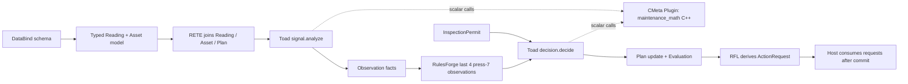

# Windowed predictive maintenance: RulesForge + Toad

This runnable example combines rule matching, a sliding observation window,
two `.toad` script modules, a C++ CMeta calculation module, forward chaining, transactional failure handling and ACE
generation publication. It is inspired by the sensor-alarm and sliding-window
examples in the [official Drools CEP documentation](https://kie.apache.org/docs/10.2.x/drools/drools/rule-engine/index.html).
The coefficients and cost model below are an illustrative policy, not a
qualified equipment-safety model or a benchmark.

## Ownership and computation



- DataBind owns schema interpretation and input binding. `Waveform` is a
  fixed-size composite with four doubles; `Model` is another fixed composite.
  Variable-size lists cannot be embedded in a composite in the selected SDK.
- RulesForge owns all facts, window membership, count/average/maximum, joins,
  agenda and rollback. The three aggregate nodes use the same constant
  `Observation(cell == "press-7")` filter before `window:length(4)`.
- Toad receives borrowed typed values during each synchronous call and returns
  a validated result copied before its fresh instance is released. The example
  enables the existing explicit-call profile: named script helpers and explicitly
  configured native Functions form the admitted callable set.
  Scripts cannot load arbitrary modules or call ambient I/O.
- CMeta Plugin owns loading/lifecycle and Toad's native-function leases. The
  generation owns an address-stable native registry. Each context attaches its
  Functions before compilation and holds a lease until final cleanup. A retired
  generation stays loaded while its original sessions remain pinned.
- The host owns input sequencing and external actions. It first fires the
  waveform-analysis stage, then inserts a `ReviewRequest` and fires the decision
  stage. These are two commits; a failed decision does not undo earlier analysis.

The first script performs two passes over the waveform, calculating mean,
population variance, mean squared successive difference and Pearson kurtosis
(zero for a constant signal). It combines the features into a bounded risk score:

```text
risk = min(100,
    10 * variance / baseline²
  +  5 * roughness / baseline²
  + 10 * abs(mean - baseline) / baseline)
```

With baseline 1, `[1,1,1,1]` scores 0, `[1,2,1,2]` scores 12.5, and
`[1,5,1,5]` reaches the policy cap of 100. Named script helpers implement the
feature extraction in `signal.toad`, then `maintenance_risk_score()` in
[`native_math.cpp`](native_math.cpp) performs calibration, weighting and the
policy cap. `decision.toad` calls `maintenance_expected_loss()` before selecting
an action. Neither script uses ambient `ts.*` builtins.

The native producer uses `TOAD_PLUGIN_FUNCTION`, `CMETA_PLUGIN_DECLARE` and the
header-only `Toad::PluginABI` target from **released Toad 0.1.3**. It links neither
the Engine nor Script runtime. The bundle grants exactly this native DSO through
`native_modules`; export IDs become direct script function names. This is the
full **RulesForge CALL → Toad → CMeta Function → C++ → typed RHS result** chain.
The native functions are stateless and support concurrent owners. Invalid
domains or unrepresentable arithmetic produce a non-finite scalar, which Toad
reports as HOST_ERROR and RulesForge propagates into the existing RHS rollback.
Native code is trusted and must not retain borrowed arguments, throw across its
C ABI, or perform effects that fact rollback cannot undo.

After at least three observations, the second script solves a constrained
choice among three actions:

```text
MONITOR cost = windowMeanRisk / 100 * failureCost * criticality
INSPECT cost = inspectionCost + 0.25 * MONITOR cost  (only with a permit)
STOP cost    = stopCost
```

The least-cost action wins; ties retain the earlier candidate. A peak risk of
90 or more forces STOP before economic comparison. The example uses costs
4 / 35 / 100 and criticality 1. Decisions create `Evaluation` facts; a second
RFL rule derives `ActionRequest` only for INSPECT or STOP. These are in-memory
requests, not delivered commands or a durable outbox.

## Expected trace

The demo inserts one waveform per step, plus one severe reading from `press-8`
before step 4. That reading must not consume `press-7` window capacity.

| Step | Signal risk | Window count | Window mean | Window peak | Action | Expected cost |
|---:|---:|---:|---:|---:|---|---:|
| 1 | 0 | 1 | warmup | warmup | WARMUP | 0 |
| 2 | 12.5 | 2 | warmup | warmup | WARMUP | 0 |
| 3 | 12.5 | 3 | 8.333333 | 12.5 | INSPECT | 6.083333 |
| 4 | 100 | 4 | 31.25 | 100 | STOP | 35 |
| 5 | 0 | 4 | 31.25 | 100 | STOP | 35 |
| 6 | 0 | 4 | 28.125 | 100 | STOP | 35 |
| 7 | 0 | 4 | 25 | 100 | STOP | 35 |
| 8 | 0 | 4 | 0 | 0 | MONITOR | 0 |

Warmup evaluations publish zero-valued mean/peak placeholders and skip the cost
optimizer. Step 8 proves the peak actually leaves every aggregate: the assertion
checks the exact final evaluation, rather than looking for a matching old result.
All nine observation facts remain session-owned; leaving the window does not
delete a fact that another rule might still need.

## Run

From the repository root, after restoring/loading the released SDK environment:

```powershell
cmake --preset native-release-user
cmake --build --preset native-release-user --parallel 3
ctest --preset native-release-user -R '^maintenance_(program_test|demo\.example)$' -V
```

Or run the example directly in the same runtime environment:

```powershell
./build/native-release-user/bin/maintenance_demo.exe build/native-release-user/examples/maintenance/bundle/bundle.json
```

The normal build prepares the original schema/scripts, generated bundle and
native provider plus `maintenance_math` module under `examples/maintenance/bundle` in the build
directory. It also prepares `bundle-conservative.json`, selecting the existing
`decide_conservative` export under the same binding name. No preset switches or
public C entry points are added. Other platforms use their native executable suffix and
preset output directory.

## Formal test matrix

The [Program regression](../../rulesforge/tests/maintenance_program_test.cpp) uses the public
C ABI and the released Toad SDK, with exact state/value assertions:

| Case | Required result |
|---|---|
| Eight-step progression | Every action, count, mean, peak and cost matches the table; five derived action requests |
| Six interleaved other-cell observations | Same three-member window and decision, despite nine retained observations |
| Missing inspection permit | MONITOR at cost 8.333333 rather than INSPECT; no action request |
| Zero calibration baseline | Script failure restores pending=false and processed=false; no observation inserted |
| Negative inspection cost | Decision fails; pending/request/plan roll back, while three prior observations remain committed |
| Malformed nested waveform | DataBind rejects the input before inserting a candidate fact |
| Two owner threads | Independent windows yield MONITOR and STOP in separate sessions |
| Conservative generation | Old session keeps MONITOR and its three observations; new session sees STOP at cost 35; a third pinned generation is rejected |
| JIT native call chain | Same three-event INSPECT decision and exact cost through C++ scalar Functions |
| Invalid native candidates | Missing/duplicate paths, partial Function/interface admission, unknown fields, wrong shapes, omitted capabilities, absolute paths and capacity overflow fail; old session stays usable |
| Native arithmetic underflow | Native HOST_ERROR rolls back pending/processed state and inserts no observation |

The conservative strategy multiplies mean risk by five for its economic model.
It does not mutate the old window, migrate facts or change the original session's
compiled bindings. The old and new generations share the same provider/runtime
version, pinned according to the existing Program contract.

The example also exposed engine gaps now covered in
[`accumulate_result_constraints_test.cpp`](../../core/test/engine/accumulate_result_constraints_test.cpp):
aggregate-result threshold admission/retraction, AND/OR composition, prior-bound
thresholds, literal IN/NOT IN and inline-bound timestamps in source arithmetic.

## Deliberate scope

This is a deterministic stateful Program and quantity-window example. It uses
neither wall-clock sleeps nor pseudo-clock emulation. It does not claim Toad
integration with ContinuousSession watermarks, lateness or replay, which remains
outside the current Program API. `press-7` is an explicit constant-filtered
window, not a general per-key window partitioning feature.

The runnable workload is bounded to eight main readings and one noise reading;
the regression adds only its specified finite inputs and destroys every session.
A four-member window does not bound all retained session facts or outputs. A
long-running deployment must separately define retention and result-consumption
ownership; it cannot treat this finite example as an unbounded event service.

The example bundle selects the interpreter; the formal suite also runs the
calculation chain in JIT mode on LLVM-MinGW x64 Release. Other platforms,
sanitizers, latency/throughput and production model quality
are separate qualification tasks. See the [Script Program guide](../../docs/SCRIPT_PROGRAM.md)
for quotas, owner-thread requirements, failure semantics and deployment.
